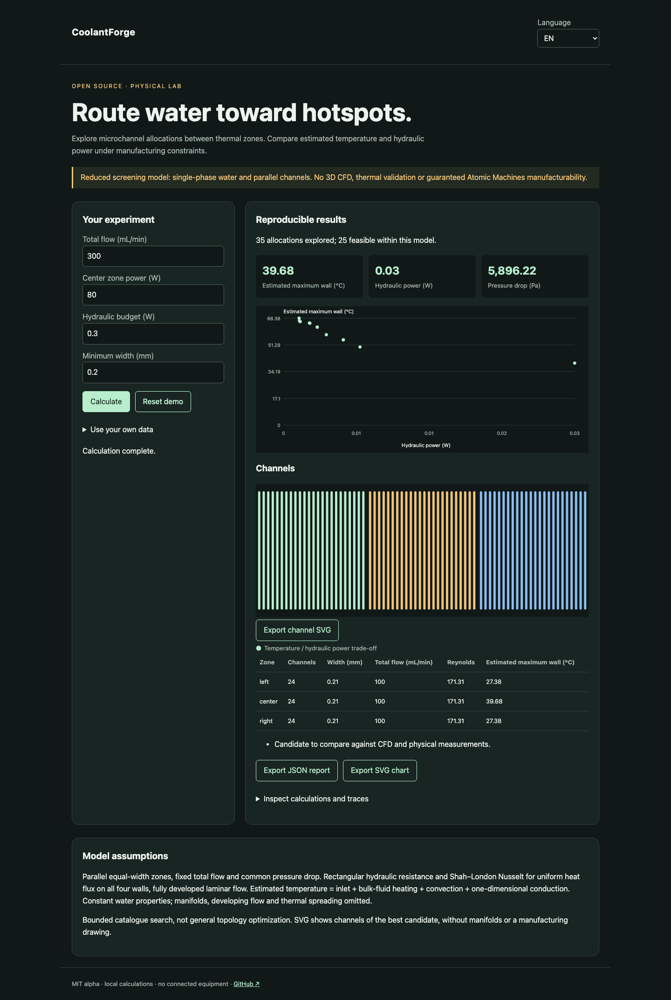

# CoolantForge

[Français](README.md) · English · [Español](README.es.md)

Explore microchannel allocations for uneven heat loads under hydraulic budget and minimum feature width.



## Try it in a minute

Node.js 22+ is sufficient for calculations and the demo. No account or API key. Open http://127.0.0.1:4321/?lang=en. `PORT=4322 npm start` changes the port; loopback only.

```sh
git clone https://github.com/gbesse/coolantforge.git
cd coolantforge
node bin/cli.js demo --locale=en
npm start
```

## Use your own data

The `fixtures/` directory contains examples. The interface accepts a file or edited JSON and exports JSON reports and SVG charts. Language changes labels, never user data or identifiers. CLI exports use exclusive `--output=new-file` creation and never overwrite existing files. Each CLI report includes SHA-256 hashes of input bytes; these do not establish measurement authenticity.

JSON supplies dimensions in mm, flow in mL/min, each zone heat load in W, inlet in °C and base conductivity in W/(m·K). The selected candidate minimizes maximum temperature among feasible catalogue allocations. No promise of fabrication on any particular machine.

```sh
node bin/cli.js run fixtures/demo.json --locale=en
```

The interface also exports an SVG schematic of selected channels. Numerical results are identical in all three languages.

## Method and limitations

Parallel equal-width zones with common length and depth; explicit walls and minimum feature width. Fixed total flow and common pressure drop. Per-channel resistance `12 μ L / [b a³ (1 − 0.630 a/b + 0.053 (a/b)⁵)]`, with `a ≤ b`. Flow is allocated by hydraulic conductance, not directly by heat load.

Water: μ = 0.001 Pa·s, ρ = 997 kg/m³, cp = 4180 J/(kg·K), k = 0.6 W/(m·K). Shah–London Nusselt for uniform heat flux on all four walls: `8.235 × (1 − 2.0421 α + 3.0853 α² − 2.4765 α³ + 1.0578 α⁴ − 0.1861 α⁵)`. Conservative temperature within this model = inlet + outlet bulk-fluid rise + convection resistance + one-dimensional base conduction.

Finite allocation catalogue search; temperature / hydraulic power Pareto front. No general topology optimization, 3D CFD, manifolds or thermal spreading. Fully developed model: entrance effects may be important at the proposed lengths and require CFD. Rejects Reynolds > 2000 or estimated temperature > 80°C; these thresholds are not industrial qualification. Hydraulic power `Δp Q` excludes pump efficiency and electrical consumption. SVG is a channel schematic, not manufacturable CAD.

## Verify

Tests check physical or statistical laws, invalid inputs, exports and browser flows in all three languages.

```sh
npm ci
npm test
npx playwright install chromium
npm run test:browser
npm run format:check
```

## Next evidence sought

Compare uniform and hotspot-aware allocations in a CFD solver, then on an instrumented plate.

## Status and contribution

Independent MIT alpha, not affiliated with Atomic Machines. No access to their hardware or API. Not published on npm. Demo fixtures are synthetic. Contribute a reproducible case with assumptions, units and expected results; publish only data you are authorized to share.

## Sources and related tools

[Glacierware](https://arxiv.org/abs/2408.15024) · [Micro-machine Universe](https://www.atomicmachines.com/blog/the-micro-machine-universe)
