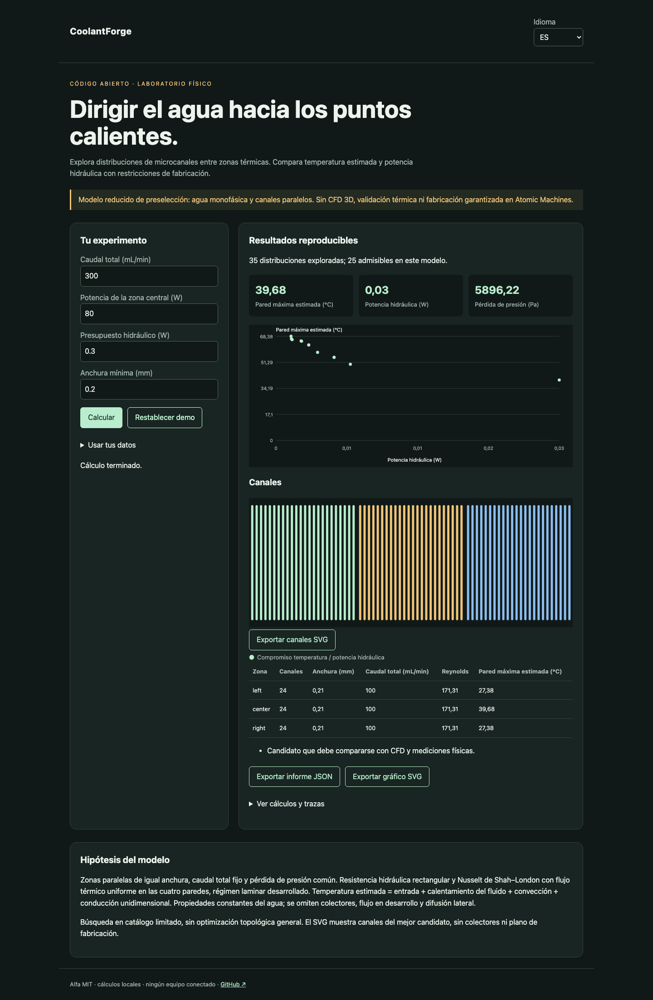

# CoolantForge

[Français](README.md) · [English](README.en.md) · Español

Explorar distribuciones de microcanales para cargas térmicas desiguales con presupuesto hidráulico y anchura mínima.



## Probar en un minuto

Node.js 22+ basta para los cálculos y la demo. Sin cuenta ni clave API. Abrir http://127.0.0.1:4321/?lang=es. `PORT=4322 npm start` cambia el puerto; solo escucha local.

```sh
git clone https://github.com/gbesse/coolantforge.git
cd coolantforge
node bin/cli.js demo --locale=es
npm start
```

## Usar tus datos

El directorio `fixtures/` contiene ejemplos. La interfaz acepta archivos o JSON editado y exporta informes JSON y gráficos SVG. El idioma cambia etiquetas, nunca datos del usuario ni identificadores. Las exportaciones CLI se crean exclusivamente con `--output=archivo-nuevo` y no sobrescriben archivos existentes. Cada informe CLI incluye hashes SHA-256 de los bytes de entrada; no prueban la autenticidad de las mediciones.

El JSON aporta dimensiones en mm, caudal en mL/min, carga térmica de cada zona en W, entrada en °C y conductividad de base en W/(m·K). El candidato minimiza temperatura máxima entre distribuciones admisibles del catálogo. Sin promesa de fabricación en una máquina concreta.

```sh
node bin/cli.js run fixtures/demo.json --locale=es
```

La interfaz también exporta un esquema SVG de canales seleccionados. Los resultados numéricos son idénticos en los tres idiomas.

## Método y límites

Zonas paralelas de igual anchura con longitud y profundidad comunes; paredes y anchura mínima explícitas. Caudal total fijo y presión común. Resistencia por canal `12 μ L / [b a³ (1 − 0,630 a/b + 0,053 (a/b)⁵)]`, con `a ≤ b`. Caudal repartido por conductancia hidráulica, no directamente por carga térmica.

Agua: μ = 0,001 Pa·s, ρ = 997 kg/m³, cp = 4180 J/(kg·K), k = 0,6 W/(m·K). Nusselt de Shah–London para flujo térmico uniforme en las cuatro paredes: `8,235 × (1 − 2,0421 α + 3,0853 α² − 2,4765 α³ + 1,0578 α⁴ − 0,1861 α⁵)`. Temperatura conservadora en este modelo = entrada + calentamiento del fluido a la salida + resistencia convectiva + conducción unidimensional de base.

Búsqueda en catálogo finito; frente de Pareto temperatura / potencia hidráulica. Sin optimización topológica general, CFD 3D, colectores ni difusión lateral. Modelo desarrollado: los efectos de entrada pueden ser importantes y requieren CFD. Rechaza Reynolds > 2000 o temperatura estimada > 80 °C; estos umbrales no califican industrialmente. Potencia hidráulica `Δp Q` excluye eficiencia y consumo eléctrico de bomba. El SVG es un esquema, no CAD fabricable.

## Verificar

Los tests comprueban leyes físicas o estadísticas, entradas no válidas, exportaciones y recorridos del navegador en los tres idiomas.

```sh
npm ci
npm test
npx playwright install chromium
npm run test:browser
npm run format:check
```

## Siguiente prueba buscada

Comparar distribución uniforme y adaptada a puntos calientes en un solver CFD y después en una placa instrumentada.

## Estado y contribución

Alfa independiente con licencia MIT, sin afiliación con Atomic Machines. Sin acceso a su hardware ni API. No publicado en npm. Los ejemplos son sintéticos. Contribuye un caso reproducible con hipótesis, unidades y resultados esperados; publica solo datos que estés autorizado a compartir.

## Fuentes y herramientas relacionadas

[Glacierware](https://arxiv.org/abs/2408.15024) · [Micro-machine Universe](https://www.atomicmachines.com/blog/the-micro-machine-universe)
