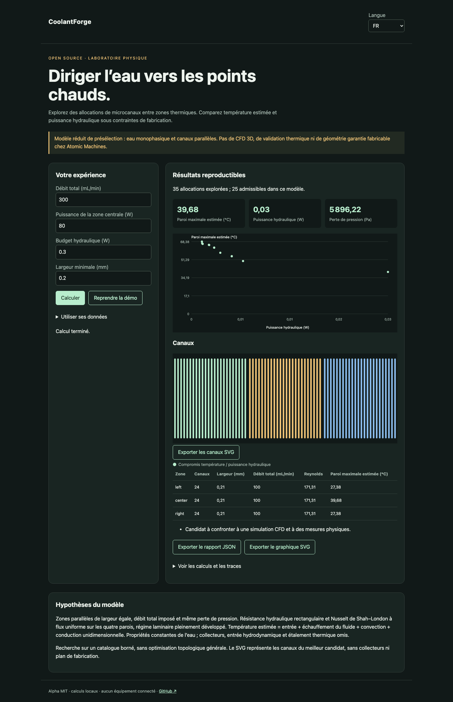

# CoolantForge

Français · [English](README.en.md) · [Español](README.es.md)

Explorer des répartitions de microcanaux pour des charges thermiques inégales, sous budget hydraulique et largeur minimale.



## Essayer en une minute

Node.js 22+ suffit pour les calculs et la démo. Aucun compte, aucune clé API. Ouvrir http://127.0.0.1:4321/?lang=fr. `PORT=4322 npm start` change le port ; écoute locale uniquement.

```sh
git clone https://github.com/gbesse/coolantforge.git
cd coolantforge
node bin/cli.js demo --locale=fr
npm start
```

## Utiliser ses données

Le dossier `fixtures/` contient les exemples. L’interface accepte un fichier ou un JSON édité et exporte le rapport JSON et le graphique SVG. La langue change les libellés, jamais les données utilisateur ni les identifiants. Les exports CLI sont créés exclusivement avec `--output=nouveau-fichier` et n’écrasent aucun fichier existant. Chaque rapport CLI contient l’empreinte SHA-256 des octets d’entrée ; elle ne prouve pas l’authenticité des mesures.

Le JSON fournit dimensions en mm, débit en mL/min, puissance thermique de chaque zone en W, entrée en °C et conductivité de la base en W/(m·K). Le candidat retenu minimise la température maximale parmi les allocations admissibles du catalogue. Aucune promesse de fabrication sur une machine particulière.

```sh
node bin/cli.js run fixtures/demo.json --locale=fr
```

L’interface exporte aussi un schéma SVG des canaux retenus. Les résultats numériques sont identiques dans les trois langues.

## Méthode et limites

Zones parallèles de même largeur, longueur et profondeur ; murs et largeur minimale explicites. Débit total imposé et pression commune. Résistance par canal `12 μ L / [b a³ (1 − 0,630 a/b + 0,053 (a/b)⁵)]` avec `a ≤ b`. Débit réparti selon la conductance hydraulique, pas directement selon la puissance thermique.

Eau : μ = 0,001 Pa·s, ρ = 997 kg/m³, cp = 4180 J/(kg·K), k = 0,6 W/(m·K). Nusselt de Shah–London pour flux uniforme sur les quatre parois : `8,235 × (1 − 2,0421 α + 3,0853 α² − 2,4765 α³ + 1,0578 α⁴ − 0,1861 α⁵)`. Température conservative dans ce modèle = entrée + échauffement du fluide à la sortie + résistance convective + conduction unidimensionnelle de la base.

Recherche dans un catalogue fini d’allocations ; front de Pareto température / puissance hydraulique. Pas d’optimisation topologique générale, de CFD 3D, de collecteurs ni d’étalement thermique. Modèle pleinement développé : les effets d’entrée peuvent être importants aux longueurs proposées et nécessitent une CFD. Rejet pour Reynolds > 2000 ou température estimée > 80 °C ; ces seuils ne constituent pas une qualification industrielle. La puissance hydraulique `Δp Q` exclut le rendement et la consommation électrique de la pompe. Le SVG est un schéma de canaux, pas un fichier CAD fabricable.

## Vérifier

Les tests vérifient les lois physiques ou statistiques, les entrées invalides, les exports et les parcours navigateur dans les trois langues.

```sh
npm ci
npm test
npx playwright install chromium
npm run test:browser
npm run format:check
```

## Prochaine preuve recherchée

Comparer une allocation uniforme et une allocation adaptée aux points chauds dans un solveur CFD, puis sur une plaque instrumentée.

## Statut et contribution

Alpha indépendante, licence MIT, sans affiliation avec Atomic Machines. Aucun accès à leur matériel ou à leur API. Aucun package publié sur npm. Les fichiers de démonstration sont synthétiques. Contribuer avec un cas reproductible, les hypothèses, les unités et les résultats attendus ; ne publier que des données que vous êtes autorisé à partager.

## Sources et outils voisins

[Glacierware](https://arxiv.org/abs/2408.15024) · [Micro-machine Universe](https://www.atomicmachines.com/blog/the-micro-machine-universe)
