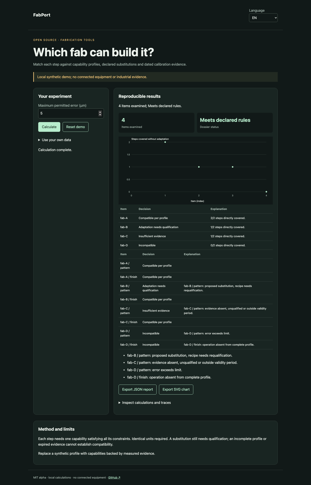

# FabPort

[Français](README.md) · [English](README.en.md) · [Español](README.es.md)

Match each step against capability profiles, declared substitutions and dated calibration evidence.



## Try it in a minute

Node.js 22+ is sufficient: no runtime dependencies, account or API key. The demo stays on loopback. Open http://127.0.0.1:4321/?lang=en.

```sh
git clone https://github.com/gbesse/fabport.git
cd fabport
node bin/cli.js demo --locale=en
npm start
```

`PORT=4322 npm start` changes the port.

## Use your own data

Import JSON in the demo, or start from `fixtures/demo.json`. Setting shortcuts apply only to the synthetic demo; imported dossiers are edited in JSON. Language changes labels and reports, never data or identifiers. JSON and SVG exports available. No network transmission of data.

```sh
node bin/cli.js run fixtures/demo.json --locale=en --output=report.json
node bin/cli.js check fixtures/demo.json --locale=en
```

`--output` exclusively creates a new file with mode 600 and refuses overwrites. CLI reports include SHA-256 of input bytes: replay integrity, not authenticity. CLI/import limit: 5 MB. `run` emits the report even for a negative decision; `check` returns 0 (`pass`), 1 (`fail`), 3 (`inconclusive`) or 2 for format/command errors.

## JSON v1 format

Required envelope: `schemaVersion: 1`, `origin: synthetic | user`. Origin is declarative; this field does not authenticate measurements. Additional fields are accepted as metadata but ignored in decisions. Physical parameters and protocols must remain in documented fields.

`asOf`, `requirements`, `fabs` and `substitutions` are required. A requirement contains `id`, `operation`, `material`, `maxErrorUm` and `range: {min, max, unit}`. A fab contains `id`, `complete` and `capabilities`. Each capability contains the same constraints and `evidence: {id, calibrationId, qualified, validFrom, validUntil}`; precision, range and evidence may be `null` to indicate missing information. A substitution contains `id`, `fromOperation`, `toOperation`, `fromMaterial`, `toMaterial`. Limits: 100 requirements, 50 fabs, 500 capabilities per fab, 100 substitutions.

## Behavior and limits

Each step needs one capability satisfying all its constraints. Identical units required. A substitution still needs qualification; an incomplete profile or expired evidence cannot establish compatibility.

The demo distinguishes four fabs: compatible, resin adaptation needing qualification, expired calibration and insufficient capability. Range and precision from different capabilities cannot be combined. An invalid alternative is not proposed as an adaptation. `pass` means at least one fab covers every step per its declarations; `fail` means all profiles are incompatible; otherwise review is required. This internal JSON format is not an OPC UA implementation or Atomic Machines SDK.

## JavaScript API

```js
import { readFile } from 'node:fs/promises';
import { analyze } from './src/index.js';
const input = JSON.parse(await readFile('fixtures/demo.json', 'utf8'));
const report = analyze(input, { locale: 'en' });
console.log(report.status, report.rows);
```

`analyze` is synchronous, deterministic and does not mutate input. Results are independent copies. Messages are localized; states and field names are stable identifiers.

## Verify and contribute

```sh
npm ci --ignore-scripts
npm test
npx playwright install chromium
npm run test:browser
npm run format:check
```

Decision tests and counterexamples, input validation, exit codes, hashes and no-overwrite exports. FR/EN/ES browser flows: changes, errors, import, language switching, exports and mobile. CI on Node 22 and 24. Contribute a reproducible case with units, assumptions, provenance and expected results; all public changes must include FR/EN/ES.

## Status and related tools

Independent MIT alpha, not affiliated with Atomic Machines. Synthetic demo examples and evidence, no connected equipment or industrial API. Standalone repository; not published on npm.

[Matter Compiler](https://www.atomicmachines.com/matter-compiler) · [PartCAD](https://github.com/partcad/partcad) · [Bluesky](https://blueskyproject.io/) · [OPC UA Job Management](https://reference.opcfoundation.org/specs/OPC-40001-3/full) · [QIF](https://www.nist.gov/publications/end-end-quality-information-framework-qif-technology-survey)
