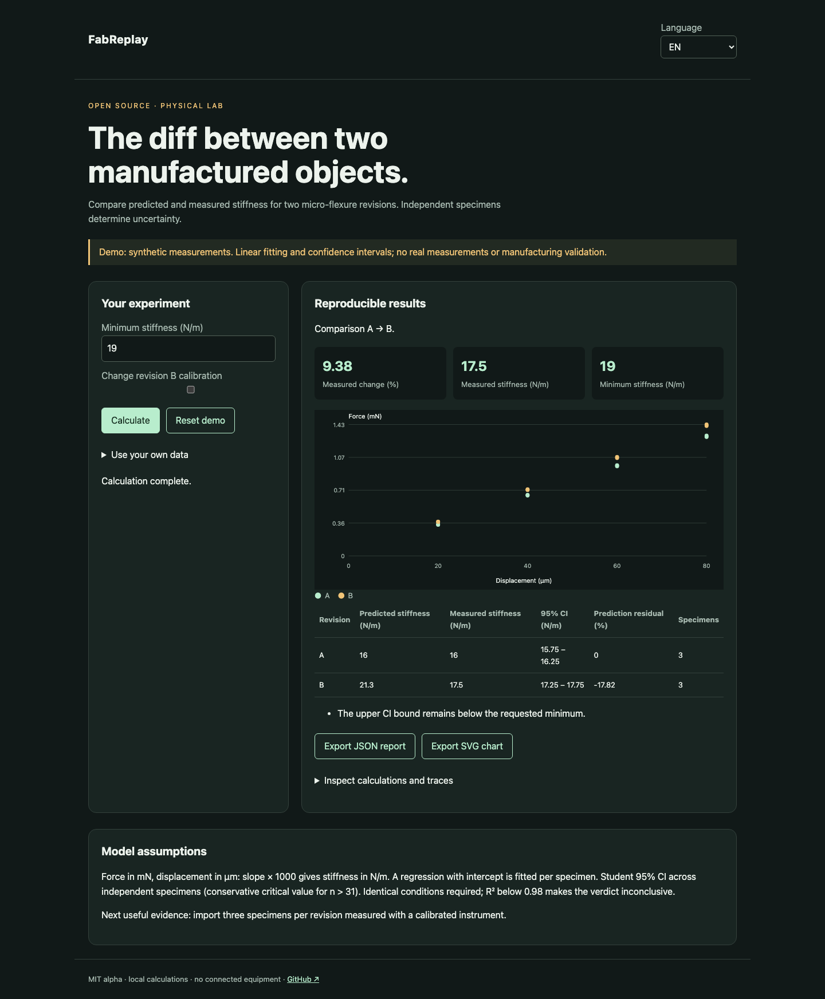

# FabReplay

[Français](README.md) · English · [Español](README.es.md)

The measurable diff between two micro-flexure revisions: prediction, tests, uncertainty and acceptance threshold.



## Try it in a minute

Node.js 22+ is sufficient for calculations and the demo. No account or API key. Open http://127.0.0.1:4321/?lang=en. `PORT=4322 npm start` changes the port; loopback only.

```sh
git clone https://github.com/gbesse/fabreplay.git
cd fabreplay
node bin/cli.js demo --locale=en
npm start
```

## Use your own data

The `fixtures/` directory contains examples. The interface accepts a file or edited JSON and exports JSON reports and SVG charts. Language changes labels, never user data or identifiers. CLI exports use exclusive `--output=new-file` creation and never overwrite existing files. Each CLI report includes SHA-256 hashes of input bytes; these do not establish measurement authenticity.

CSV requires exactly `specimen_id,displacement_um,force_mn`. CSV files replace points, not conditions in JSON.

```sh
node bin/cli.js run fixtures/demo.json --baseline-csv=fixtures/a.csv --candidate-csv=fixtures/b.csv --locale=en
```

For a CI gate: `node bin/cli.js check file.json`. Exit codes: 0 passes, 1 below minimum, 3 inconclusive, 2 invalid input. Demo intentionally fails the 19 N/m threshold: B predicts 21.296 N/m but measures 17.5 N/m.

## Method and limitations

Each revision contains `id`, `predictedStiffnessNPerM`, conditions `instrument`, `calibration`, `fixture`, `temperatureC`, and measurements `{ specimenId, displacementUm, forceMn }`. At least three independent specimens and three points per specimen. Regression with intercept; slope mN/µm × 1000 = N/m. Mean and Student 95% CI across specimens, assuming independence and approximately normal stiffness values. Conservative critical value above 31 specimens. Repeated points on the same specimen do not increase independent sample size.

`minimumStiffnessNPerM` is an explicit requirement, not an assumption that stiffer is always better. `pass` if the lower CI bound meets the minimum; `fail` if the upper bound remains below it; otherwise `inconclusive`. Changed conditions or R² < 0.98 force `inconclusive`. Revision differences use a conservative CI between two independent groups. Intervals exclude systematic errors, calibration uncertainty and model bias.

`flexureStiffness()` calculates a tip-loaded cantilever (Euler–Bernoulli, small deflection) for illustration. It is not a finite-element simulation of the part.

## Verify

Tests check physical or statistical laws, invalid inputs, exports and browser flows in all three languages.

```sh
npm ci
npm test
npx playwright install chromium
npm run test:browser
npm run format:check
```

## Next evidence sought

An open dataset from two revisions and at least three specimens each, with documented protocol and calibration.

## Status and contribution

Independent MIT alpha, not affiliated with Atomic Machines. No access to their hardware or API. Not published on npm. Demo fixtures are synthetic. Contribute a reproducible case with assumptions, units and expected results; publish only data you are authorized to share.

## Sources and related tools

[Matter Compiler](https://www.atomicmachines.com/matter-compiler) · [CADCLAW](https://github.com/sunnyday-technologies/CADCLAW)
