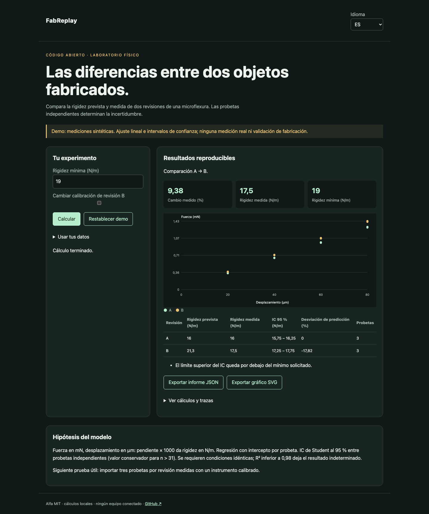

# FabReplay

[Français](README.md) · [English](README.en.md) · Español

Las diferencias medibles entre dos revisiones de microflexuras: predicción, ensayos, incertidumbre y umbral de aceptación.



## Probar en un minuto

Node.js 22+ basta para los cálculos y la demo. Sin cuenta ni clave API. Abrir http://127.0.0.1:4321/?lang=es. `PORT=4322 npm start` cambia el puerto; solo escucha local.

```sh
git clone https://github.com/gbesse/fabreplay.git
cd fabreplay
node bin/cli.js demo --locale=es
npm start
```

## Usar tus datos

El directorio `fixtures/` contiene ejemplos. La interfaz acepta archivos o JSON editado y exporta informes JSON y gráficos SVG. El idioma cambia etiquetas, nunca datos del usuario ni identificadores. Las exportaciones CLI se crean exclusivamente con `--output=archivo-nuevo` y no sobrescriben archivos existentes. Cada informe CLI incluye hashes SHA-256 de los bytes de entrada; no prueban la autenticidad de las mediciones.

El CSV requiere exactamente `specimen_id,displacement_um,force_mn`. Sustituye los puntos, no las condiciones del JSON.

```sh
node bin/cli.js run fixtures/demo.json --baseline-csv=fixtures/a.csv --candidate-csv=fixtures/b.csv --locale=es
```

Para una barrera CI: `node bin/cli.js check archivo.json`. Códigos: 0 cumple, 1 bajo el mínimo, 3 indeterminado, 2 error de entrada. La demo falla intencionadamente el umbral de 19 N/m: B predice 21,296 N/m pero mide 17,5 N/m.

## Método y límites

Cada revisión contiene `id`, `predictedStiffnessNPerM`, condiciones `instrument`, `calibration`, `fixture`, `temperatureC` y mediciones `{ specimenId, displacementUm, forceMn }`. Al menos tres probetas independientes y tres puntos por probeta. Regresión con intercepto; pendiente mN/µm × 1000 = N/m. Media e IC de Student al 95 % entre probetas, suponiendo independencia y rigideces aproximadamente normales. Valor crítico conservador con más de 31 probetas. Repetir puntos de la misma probeta no aumenta el tamaño independiente.

`minimumStiffnessNPerM` es un requisito explícito, no una suposición de que más rígido sea siempre mejor. `pass` si el límite inferior del IC alcanza el mínimo; `fail` si el superior queda debajo; si no, `inconclusive`. Cambiar condiciones o R² < 0,98 fuerza `inconclusive`. La diferencia entre revisiones usa un IC conservador entre dos grupos independientes. Los intervalos excluyen errores sistemáticos, incertidumbre de calibración y sesgo del modelo.

`flexureStiffness()` calcula una viga empotrada con carga en punta (Euler–Bernoulli, pequeña deformación) como ilustración. No es una simulación FEM de la pieza.

## Verificar

Los tests comprueban leyes físicas o estadísticas, entradas no válidas, exportaciones y recorridos del navegador en los tres idiomas.

```sh
npm ci
npm test
npx playwright install chromium
npm run test:browser
npm run format:check
```

## Siguiente prueba buscada

Un conjunto abierto de mediciones de dos revisiones y al menos tres probetas por revisión, con protocolo y calibración documentados.

## Estado y contribución

Alfa independiente con licencia MIT, sin afiliación con Atomic Machines. Sin acceso a su hardware ni API. No publicado en npm. Los ejemplos son sintéticos. Contribuye un caso reproducible con hipótesis, unidades y resultados esperados; publica solo datos que estés autorizado a compartir.

## Fuentes y herramientas relacionadas

[Matter Compiler](https://www.atomicmachines.com/matter-compiler) · [CADCLAW](https://github.com/sunnyday-technologies/CADCLAW)
