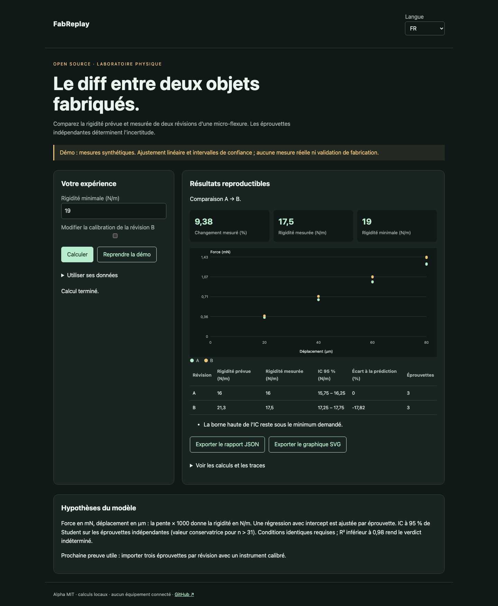

# FabReplay

Français · [English](README.en.md) · [Español](README.es.md)

Le diff mesurable entre deux révisions de micro-flexures : prédiction, essais, incertitude et seuil d’acceptation.



## Essayer en une minute

Node.js 22+ suffit pour les calculs et la démo. Aucun compte, aucune clé API. Ouvrir http://127.0.0.1:4321/?lang=fr. `PORT=4322 npm start` change le port ; écoute locale uniquement.

```sh
git clone https://github.com/gbesse/fabreplay.git
cd fabreplay
node bin/cli.js demo --locale=fr
npm start
```

## Utiliser ses données

Le dossier `fixtures/` contient les exemples. L’interface accepte un fichier ou un JSON édité et exporte le rapport JSON et le graphique SVG. La langue change les libellés, jamais les données utilisateur ni les identifiants. Les exports CLI sont créés exclusivement avec `--output=nouveau-fichier` et n’écrasent aucun fichier existant. Chaque rapport CLI contient l’empreinte SHA-256 des octets d’entrée ; elle ne prouve pas l’authenticité des mesures.

Les CSV doivent avoir exactement `specimen_id,displacement_um,force_mn`. Les fichiers CSV remplacent les points, pas les conditions du JSON.

```sh
node bin/cli.js run fixtures/demo.json --baseline-csv=fixtures/a.csv --candidate-csv=fixtures/b.csv --locale=fr
```

Pour une barrière CI : `node bin/cli.js check fichier.json`. Codes : 0 conforme, 1 sous le minimum, 3 indéterminé, 2 erreur d’entrée. La démo échoue volontairement au seuil de 19 N/m : rigidité B prévue 21,296 N/m mais mesurée 17,5 N/m.

## Méthode et limites

Chaque révision contient un `id`, une `predictedStiffnessNPerM`, les conditions `instrument`, `calibration`, `fixture`, `temperatureC`, et des mesures `{ specimenId, displacementUm, forceMn }`. Trois éprouvettes indépendantes et trois points au minimum par éprouvette. Régression avec intercept ; pente mN/µm × 1000 = N/m. Moyenne et IC de Student à 95 % entre éprouvettes, en supposant indépendance et distribution approximativement normale des rigidités. Valeur critique conservatrice pour plus de 31 éprouvettes. Les mesures répétées sur la même éprouvette n’augmentent pas l’effectif indépendant.

`minimumStiffnessNPerM` est une exigence explicite, pas une hypothèse selon laquelle plus rigide serait toujours mieux. `pass` si la borne basse de l’IC atteint le minimum ; `fail` si la borne haute reste sous le minimum ; sinon `inconclusive`. Un changement de conditions ou R² < 0,98 force `inconclusive`. La différence entre révisions utilise un IC conservateur entre deux groupes indépendants. Les intervalles excluent les erreurs systématiques, les incertitudes de calibration et le biais du modèle.

`flexureStiffness()` calcule une poutre encastrée chargée en bout (Euler–Bernoulli, petite déformation), pour illustration. Ce n’est pas une simulation FEM de la pièce.

## Vérifier

Les tests vérifient les lois physiques ou statistiques, les entrées invalides, les exports et les parcours navigateur dans les trois langues.

```sh
npm ci
npm test
npx playwright install chromium
npm run test:browser
npm run format:check
```

## Prochaine preuve recherchée

Un jeu de mesures ouvert provenant de deux révisions et d’au moins trois éprouvettes par révision, avec protocole et calibration documentés.

## Statut et contribution

Alpha indépendante, licence MIT, sans affiliation avec Atomic Machines. Aucun accès à leur matériel ou à leur API. Aucun package publié sur npm. Les fichiers de démonstration sont synthétiques. Contribuer avec un cas reproductible, les hypothèses, les unités et les résultats attendus ; ne publier que des données que vous êtes autorisé à partager.

## Sources et outils voisins

[Matter Compiler](https://www.atomicmachines.com/matter-compiler) · [CADCLAW](https://github.com/sunnyday-technologies/CADCLAW)
