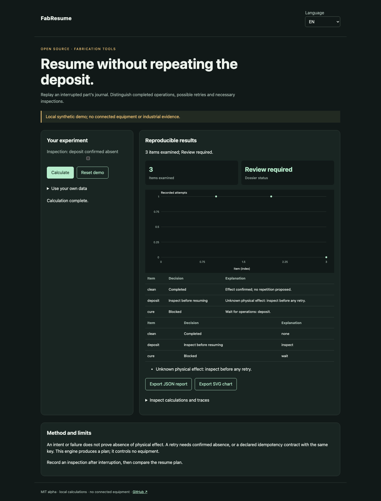

# FabResume

[Français](README.md) · [English](README.en.md) · [Español](README.es.md)

Replay an interrupted part’s journal. Distinguish completed operations, possible retries and necessary inspections.



## Try it in a minute

Node.js 22+ is sufficient: no runtime dependencies, account or API key. The demo stays on loopback. Open http://127.0.0.1:4321/?lang=en.

```sh
git clone https://github.com/gbesse/fabresume.git
cd fabresume
node bin/cli.js demo --locale=en
npm start
```

`PORT=4322 npm start` changes the port.

## Use your own data

Import JSON in the demo, or start from `fixtures/demo.json`. Setting shortcuts apply only to the synthetic demo; imported dossiers are edited in JSON. Language changes labels and reports, never data or identifiers. JSON and SVG exports available. No network transmission of data.

```sh
node bin/cli.js run fixtures/demo.json --locale=en --output=report.json
node bin/cli.js check fixtures/demo.json --locale=en
```

`--output` exclusively creates a new file with mode 600 and refuses overwrites. CLI reports include SHA-256 of input bytes: replay integrity, not authenticity. CLI/import limit: 5 MB. `run` emits the report even for a negative decision; `check` returns 0 (`pass`), 1 (`fail`), 3 (`inconclusive`) or 2 for format/command errors.

## JSON v1 format

Required envelope: `schemaVersion: 1`, `origin: synthetic | user`. Origin is declarative; this field does not authenticate measurements. Additional fields are accepted as metadata but ignored in decisions. Physical parameters and protocols must remain in documented fields.

`partId`, `operations` and `journal` are required. An operation contains `id`, `kind`, `parameters`, `dependsOn`, `retryMode` (`inspect`, `idempotent`, `never`) and `maxAttempts` (1–10). An event contains `id`, strictly increasing `seq`, `operationId`, `attemptId`, `type`: `intent`, `started`, `completed`, `failed`, `interrupted`, `inspection`. `intent` requires an `idempotencyKey`. Each intent also stores `commandBasis`, obtained with `operationBasis(operation)`; changing kind or parameters makes the journal inconsistent and prevents replay. Inspection requires `physicalOutcome`: `applied`, `not_applied`, `unknown`. Unique event identifiers. Limits: 500 operations, 2,000 events. Single-part journal; no part aggregation or command execution.

## Behavior and limits

An intent or failure does not prove absence of physical effect. A retry needs confirmed absence, or a declared idempotency contract with the same key. This engine produces a plan; it controls no equipment.

The demo loses a deposit result: inspection is required and curing remains blocked. `applied` prevents repetition; `not_applied` permits another attempt if rule and budget allow. Running commands wait for results. Intent without confirmed start remains ambiguous. An `idempotent` contract is an assumption about equipment: only replay with the same key is proposed. Duplicate journal events are rejected. No exactly-once delivery or automatic physical recovery guarantee.

## JavaScript API

```js
import { readFile } from 'node:fs/promises';
import { analyze } from './src/index.js';
const input = JSON.parse(await readFile('fixtures/demo.json', 'utf8'));
const report = analyze(input, { locale: 'en' });
console.log(report.status, report.rows);
```

`analyze` is synchronous, deterministic and does not mutate input. Results are independent copies. Messages are localized; states and field names are stable identifiers.

## Verify and contribute

```sh
npm ci --ignore-scripts
npm test
npx playwright install chromium
npm run test:browser
npm run format:check
```

Decision tests and counterexamples, input validation, exit codes, hashes and no-overwrite exports. FR/EN/ES browser flows: changes, errors, import, language switching, exports and mobile. CI on Node 22 and 24. Contribute a reproducible case with units, assumptions, provenance and expected results; all public changes must include FR/EN/ES.

## Status and related tools

Independent MIT alpha, not affiliated with Atomic Machines. Synthetic demo examples and evidence, no connected equipment or industrial API. Standalone repository; not published on npm.

[Matter Compiler](https://www.atomicmachines.com/matter-compiler) · [PartCAD](https://github.com/partcad/partcad) · [Bluesky](https://blueskyproject.io/) · [OPC UA Job Management](https://reference.opcfoundation.org/specs/OPC-40001-3/full) · [QIF](https://www.nist.gov/publications/end-end-quality-information-framework-qif-technology-survey)
