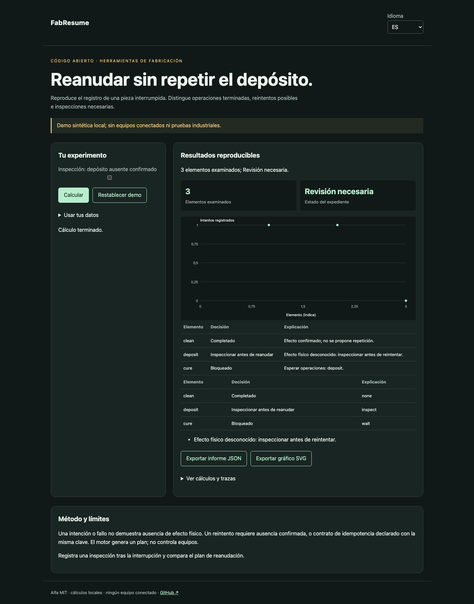

# FabResume

[Français](README.md) · [English](README.en.md) · [Español](README.es.md)

Reproduce el registro de una pieza interrumpida. Distingue operaciones terminadas, reintentos posibles e inspecciones necesarias.



## Probar en un minuto

Node.js 22+ basta: sin dependencias de ejecución, cuenta ni clave API. La demo permanece en loopback. Abrir http://127.0.0.1:4321/?lang=es.

```sh
git clone https://github.com/gbesse/fabresume.git
cd fabresume
node bin/cli.js demo --locale=es
npm start
```

`PORT=4322 npm start` cambia el puerto.

## Usar tus datos

Importa JSON en la demo, o parte de `fixtures/demo.json`. Los atajos de ajustes solo afectan la demo sintética; expedientes importados se editan en JSON. Cambiar idioma traduce etiquetas e informes, nunca datos ni identificadores. Exportaciones JSON y SVG disponibles. Sin transmisión de datos por red.

```sh
node bin/cli.js run fixtures/demo.json --locale=es --output=report.json
node bin/cli.js check fixtures/demo.json --locale=es
```

`--output` crea exclusivamente un archivo nuevo con modo 600 y rechaza sobrescrituras. Informes CLI incluyen SHA-256 de bytes de entrada: integridad de reproducción, no autenticidad. Límite CLI/importación: 5 MB. `run` genera informe incluso con decisión negativa; `check` devuelve 0 (`pass`), 1 (`fail`), 3 (`inconclusive`) o 2 para errores de formato/orden.

## Formato JSON v1

Envoltura obligatoria: `schemaVersion: 1`, `origin: synthetic | user`. Origen declarativo; el campo no autentica mediciones. Campos adicionales aceptados como metadatos pero ignorados en decisiones. Parámetros físicos y protocolos deben permanecer en campos documentados.

`partId`, `operations` y `journal` son obligatorios. Una operación contiene `id`, `kind`, `parameters`, `dependsOn`, `retryMode` (`inspect`, `idempotent`, `never`) y `maxAttempts` (1–10). Un evento contiene `id`, `seq` estrictamente creciente, `operationId`, `attemptId`, `type`: `intent`, `started`, `completed`, `failed`, `interrupted`, `inspection`. `intent` requiere `idempotencyKey`. Cada intención conserva también `commandBasis`, obtenido con `operationBasis(operation)`; cambiar tipo o parámetros hace el registro incoherente e impide repetirlo. Una inspección requiere `physicalOutcome`: `applied`, `not_applied`, `unknown`. Identificadores de eventos únicos. Límites: 500 operaciones, 2000 eventos. Registro de una sola pieza; sin agrupación de piezas ni ejecución de órdenes.

## Comportamiento y límites

Una intención o fallo no demuestra ausencia de efecto físico. Un reintento requiere ausencia confirmada, o contrato de idempotencia declarado con la misma clave. El motor genera un plan; no controla equipos.

La demo pierde el resultado de un depósito: requiere inspección y el curado permanece bloqueado. `applied` evita repetir; `not_applied` permite otro intento si regla y presupuesto lo admiten. Las órdenes activas esperan resultados. Una intención sin inicio confirmado sigue siendo ambigua. El contrato `idempotent` es una hipótesis sobre el equipo: solo se propone repetición con la misma clave. Eventos duplicados rechazados. Sin garantía de entrega exactamente una vez ni recuperación física automática.

## API JavaScript

```js
import { readFile } from 'node:fs/promises';
import { analyze } from './src/index.js';
const input = JSON.parse(await readFile('fixtures/demo.json', 'utf8'));
const report = analyze(input, { locale: 'es' });
console.log(report.status, report.rows);
```

`analyze` es síncrono, determinista y no modifica entrada. Resultados son copias independientes. Mensajes localizados; estados y nombres de campos son identificadores estables.

## Verificar y contribuir

```sh
npm ci --ignore-scripts
npm test
npx playwright install chromium
npm run test:browser
npm run format:check
```

Pruebas de decisiones y contraejemplos, validación de entrada, códigos de salida, hashes y exportaciones sin sobrescritura. Flujos FR/EN/ES: cambios, errores, importación, idioma, exportaciones y móvil. CI en Node 22 y 24. Contribuye casos reproducibles con unidades, hipótesis, procedencia y resultados esperados; todo cambio público debe incluir FR/EN/ES.

## Estado y herramientas relacionadas

Alfa independiente bajo MIT, sin afiliación a Atomic Machines. Ejemplos y pruebas de demo sintéticos, sin equipos ni API industrial conectados. Repositorio autónomo; no publicado en npm.

[Matter Compiler](https://www.atomicmachines.com/matter-compiler) · [PartCAD](https://github.com/partcad/partcad) · [Bluesky](https://blueskyproject.io/) · [OPC UA Job Management](https://reference.opcfoundation.org/specs/OPC-40001-3/full) · [QIF](https://www.nist.gov/publications/end-end-quality-information-framework-qif-technology-survey)
