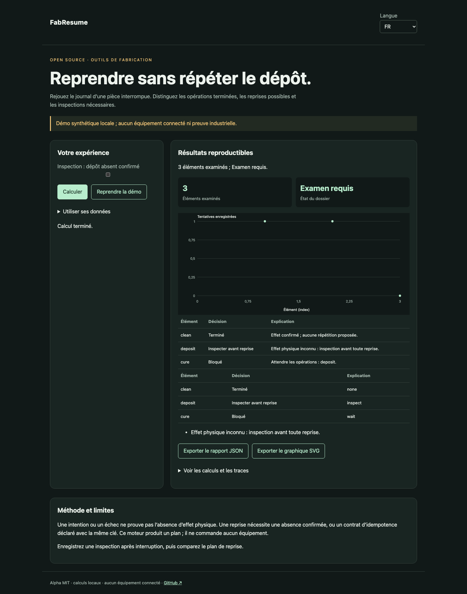

# FabResume

[Français](README.md) · [English](README.en.md) · [Español](README.es.md)

Rejouez le journal d’une pièce interrompue. Distinguez les opérations terminées, les reprises possibles et les inspections nécessaires.



## Essayer en une minute

Node.js 22+ suffit : aucune dépendance d’exécution, aucun compte ni clé API. La démo reste sur la boucle locale. Ouvrir http://127.0.0.1:4321/?lang=fr.

```sh
git clone https://github.com/gbesse/fabresume.git
cd fabresume
node bin/cli.js demo --locale=fr
npm start
```

`PORT=4322 npm start` change le port.

## Utiliser ses données

Importer un JSON dans la démo, ou partir de `fixtures/demo.json`. Les raccourcis de réglage concernent uniquement la démo synthétique ; les dossiers importés se modifient dans le JSON. Changer la langue traduit les libellés et rapports, jamais les données ou identifiants. Exports JSON et SVG disponibles. Aucun envoi réseau des données.

```sh
node bin/cli.js run fixtures/demo.json --locale=fr --output=report.json
node bin/cli.js check fixtures/demo.json --locale=fr
```

`--output` crée exclusivement un nouveau fichier en mode 600 et refuse tout écrasement. Les rapports CLI contiennent le SHA-256 des octets d’entrée : intégrité de rejeu, sans preuve d’authenticité. Limite CLI/import : 5 Mo. `run` produit le rapport même si la décision est négative ; `check` retourne 0 (`pass`), 1 (`fail`), 3 (`inconclusive`) ou 2 pour une erreur de format/commande.

## Format JSON v1

Enveloppe requise : `schemaVersion: 1`, `origin: synthetic | user`. L’origine est déclarative ; ce champ n’authentifie pas les mesures. Champs additionnels acceptés comme métadonnées mais ignorés dans les décisions. Les paramètres physiques et protocoles doivent rester dans les champs documentés.

`partId`, `operations` et `journal` sont requis. Une opération contient `id`, `kind`, `parameters`, `dependsOn`, `retryMode` (`inspect`, `idempotent`, `never`) et `maxAttempts` (1–10). Un événement contient `id`, `seq` strictement croissant, `operationId`, `attemptId`, `type` : `intent`, `started`, `completed`, `failed`, `interrupted`, `inspection`. `intent` exige une `idempotencyKey`. Chaque intention conserve aussi `commandBasis`, obtenu avec `operationBasis(operation)` ; un changement de type ou de paramètres rend le journal incohérent et interdit son rejeu. Une inspection exige `physicalOutcome` : `applied`, `not_applied`, `unknown`. Identifiants d’événements uniques. Limites : 500 opérations, 2 000 événements. Journal d’une seule pièce ; aucun regroupement de pièces ni exécution de commandes.

## Comportement et limites

Une intention ou un échec ne prouve pas l’absence d’effet physique. Une reprise nécessite une absence confirmée, ou un contrat d’idempotence déclaré avec la même clé. Ce moteur produit un plan ; il ne commande aucun équipement.

La démo perd le résultat d’un dépôt : une inspection est requise et la cuisson reste bloquée. `applied` évite toute répétition ; `not_applied` permet une nouvelle tentative si la règle et le budget le permettent. Une commande en cours attend son résultat. Une intention sans démarrage confirmé reste ambiguë. Un contrat `idempotent` est une hypothèse sur l’équipement : seul le rejeu avec la même clé est proposé. Les doublons de journal sont rejetés. Aucune garantie de livraison exactement une fois ni de reprise physique automatique.

## API JavaScript

```js
import { readFile } from 'node:fs/promises';
import { analyze } from './src/index.js';
const input = JSON.parse(await readFile('fixtures/demo.json', 'utf8'));
const report = analyze(input, { locale: 'fr' });
console.log(report.status, report.rows);
```

`analyze` est synchrone, déterministe et ne modifie pas l’entrée. Les résultats sont des copies indépendantes. Les messages sont localisés ; les états et noms de champs sont des identifiants stables.

## Vérifier et contribuer

```sh
npm ci --ignore-scripts
npm test
npx playwright install chromium
npm run test:browser
npm run format:check
```

Tests de décisions et contre-exemples, validation des entrées, codes de sortie, empreintes et exports sans écrasement. Parcours navigateur FR/EN/ES : modification, erreurs, import, changement de langue, exports et mobile. CI sur Node 22 et 24. Contribuer un cas reproductible avec unités, hypothèses, provenance et résultats attendus ; toute évolution publique doit inclure FR/EN/ES.

## État et outils associés

Alpha indépendante sous MIT, non affiliée à Atomic Machines. Exemples et preuves de démonstration synthétiques, aucun équipement ni API industrielle connecté. Dépôt autonome ; pas de publication npm.

[Matter Compiler](https://www.atomicmachines.com/matter-compiler) · [PartCAD](https://github.com/partcad/partcad) · [Bluesky](https://blueskyproject.io/) · [OPC UA Job Management](https://reference.opcfoundation.org/specs/OPC-40001-3/full) · [QIF](https://www.nist.gov/publications/end-end-quality-information-framework-qif-technology-survey)
