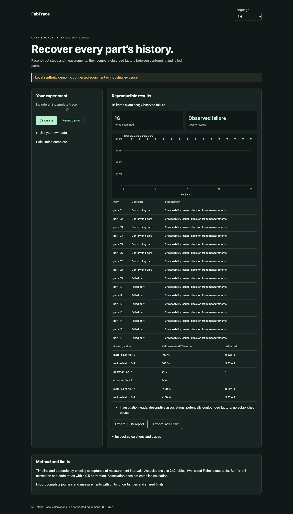

# FabTrace

[Français](README.md) · [English](README.en.md) · [Español](README.es.md)

Reconstruct steps and measurements, then compare observed factors between conforming and failed parts.



## Try it in a minute

Node.js 22+ is sufficient: no runtime dependencies, account or API key. The demo stays on loopback. Open http://127.0.0.1:4321/?lang=en.

```sh
git clone https://github.com/gbesse/fabtrace.git
cd fabtrace
node bin/cli.js demo --locale=en
npm start
```

`PORT=4322 npm start` changes the port.

## Use your own data

Import JSON in the demo, or start from `fixtures/demo.json`. Setting shortcuts apply only to the synthetic demo; imported dossiers are edited in JSON. Language changes labels and reports, never data or identifiers. JSON and SVG exports available. No network transmission of data.

```sh
node bin/cli.js run fixtures/demo.json --locale=en --output=report.json
node bin/cli.js check fixtures/demo.json --locale=en
```

`--output` exclusively creates a new file with mode 600 and refuses overwrites. CLI reports include SHA-256 of input bytes: replay integrity, not authenticity. CLI/import limit: 5 MB. `run` emits the report even for a negative decision; `check` returns 0 (`pass`), 1 (`fail`), 3 (`inconclusive`) or 2 for format/command errors.

## JSON v1 format

Required envelope: `schemaVersion: 1`, `origin: synthetic | user`. Origin is declarative; this field does not authenticate measurements. Additional fields are accepted as metadata but ignored in decisions. Physical parameters and protocols must remain in documented fields.

`operations`, `requirements` and `parts` are required. An operation contains `id`, `dependsOn`. A requirement contains `id`, `operationId`, `metric`, `unit`, `limits: {min, max}`. A part contains `id`, `facts` (string categorical factors), `events` and `measurements`. An event contains `id`, `seq`, `operationId`, `type` (`start`/`finish`), ISO UTC `time` and `parameters`. A measurement contains `id`, `requirementId`, `value`, `uncertainty95`, `unit`. Exact units, no conversion. Limits: 100 operations, 100 requirements, 500 parts, 500 events and measurements per part. An operation executes once; repeated attempts belong in FabResume.

## Behavior and limits

Timeline and dependency checks; acceptance of measurement intervals. Associations use 2×2 tables, two-sided Fisher exact tests, Bonferroni correction and odds ratios with a 0.5 correction. Association does not establish causation.

The demo contains 16 parts: 8 conforming and 8 failing. Material lot and recipe version change together: they produce the same association and cannot be causally distinguished. Incomplete traces and inconclusive measurements are excluded from associations. Missing values are not treated as controls. At least two exposed and two unexposed parts are needed per comparison. Adjusted p-values cover comparisons in the report, not all possible analyses. Part independence is assumed; correlated batches can invalidate statistical interpretation. No QIF/OPC UA connector or automatic causal diagnosis.

## JavaScript API

```js
import { readFile } from 'node:fs/promises';
import { analyze } from './src/index.js';
const input = JSON.parse(await readFile('fixtures/demo.json', 'utf8'));
const report = analyze(input, { locale: 'en' });
console.log(report.status, report.rows);
```

`analyze` is synchronous, deterministic and does not mutate input. Results are independent copies. Messages are localized; states and field names are stable identifiers.

## Verify and contribute

```sh
npm ci --ignore-scripts
npm test
npx playwright install chromium
npm run test:browser
npm run format:check
```

Decision tests and counterexamples, input validation, exit codes, hashes and no-overwrite exports. FR/EN/ES browser flows: changes, errors, import, language switching, exports and mobile. CI on Node 22 and 24. Contribute a reproducible case with units, assumptions, provenance and expected results; all public changes must include FR/EN/ES.

## Status and related tools

Independent MIT alpha, not affiliated with Atomic Machines. Synthetic demo examples and evidence, no connected equipment or industrial API. Standalone repository; not published on npm.

[Matter Compiler](https://www.atomicmachines.com/matter-compiler) · [PartCAD](https://github.com/partcad/partcad) · [Bluesky](https://blueskyproject.io/) · [OPC UA Job Management](https://reference.opcfoundation.org/specs/OPC-40001-3/full) · [QIF](https://www.nist.gov/publications/end-end-quality-information-framework-qif-technology-survey)
