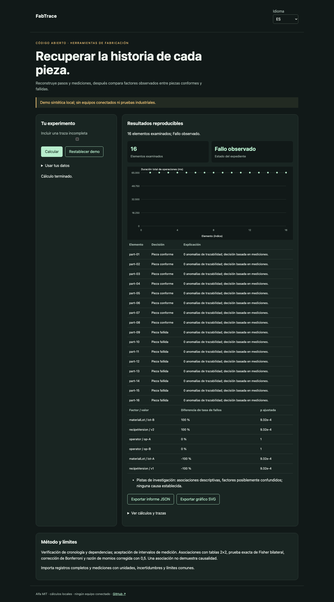

# FabTrace

[Français](README.md) · [English](README.en.md) · [Español](README.es.md)

Reconstruye pasos y mediciones, después compara factores observados entre piezas conformes y fallidas.



## Probar en un minuto

Node.js 22+ basta: sin dependencias de ejecución, cuenta ni clave API. La demo permanece en loopback. Abrir http://127.0.0.1:4321/?lang=es.

```sh
git clone https://github.com/gbesse/fabtrace.git
cd fabtrace
node bin/cli.js demo --locale=es
npm start
```

`PORT=4322 npm start` cambia el puerto.

## Usar tus datos

Importa JSON en la demo, o parte de `fixtures/demo.json`. Los atajos de ajustes solo afectan la demo sintética; expedientes importados se editan en JSON. Cambiar idioma traduce etiquetas e informes, nunca datos ni identificadores. Exportaciones JSON y SVG disponibles. Sin transmisión de datos por red.

```sh
node bin/cli.js run fixtures/demo.json --locale=es --output=report.json
node bin/cli.js check fixtures/demo.json --locale=es
```

`--output` crea exclusivamente un archivo nuevo con modo 600 y rechaza sobrescrituras. Informes CLI incluyen SHA-256 de bytes de entrada: integridad de reproducción, no autenticidad. Límite CLI/importación: 5 MB. `run` genera informe incluso con decisión negativa; `check` devuelve 0 (`pass`), 1 (`fail`), 3 (`inconclusive`) o 2 para errores de formato/orden.

## Formato JSON v1

Envoltura obligatoria: `schemaVersion: 1`, `origin: synthetic | user`. Origen declarativo; el campo no autentica mediciones. Campos adicionales aceptados como metadatos pero ignorados en decisiones. Parámetros físicos y protocolos deben permanecer en campos documentados.

`operations`, `requirements` y `parts` son obligatorios. Una operación contiene `id`, `dependsOn`. Un requisito contiene `id`, `operationId`, `metric`, `unit`, `limits: {min, max}`. Una pieza contiene `id`, `facts` (factores categóricos de tipo cadena), `events` y `measurements`. Un evento contiene `id`, `seq`, `operationId`, `type` (`start`/`finish`), `time` UTC ISO y `parameters`. Una medición contiene `id`, `requirementId`, `value`, `uncertainty95`, `unit`. Unidades exactas, sin conversión. Límites: 100 operaciones, 100 requisitos, 500 piezas, 500 eventos y mediciones por pieza. Cada operación se ejecuta una vez; los intentos repetidos corresponden a FabResume.

## Comportamiento y límites

Verificación de cronología y dependencias; aceptación de intervalos de medición. Asociaciones con tablas 2×2, prueba exacta de Fisher bilateral, corrección de Bonferroni y razón de momios corregida con 0,5. Una asociación no demuestra causalidad.

La demo contiene 16 piezas: 8 conformes y 8 fallidas. Lote y versión de receta cambian juntos: producen la misma asociación y no se distinguen causalmente. Trazas incompletas y mediciones indeterminadas excluidas de asociaciones. Valores ausentes no tratados como controles. Se requieren al menos dos piezas expuestas y dos no expuestas por comparación. p ajustadas cubren comparaciones del informe, no todos los análisis posibles. Se supone independencia de piezas; lotes correlacionados pueden invalidar interpretación estadística. Sin conector QIF/OPC UA ni diagnóstico causal automático.

## API JavaScript

```js
import { readFile } from 'node:fs/promises';
import { analyze } from './src/index.js';
const input = JSON.parse(await readFile('fixtures/demo.json', 'utf8'));
const report = analyze(input, { locale: 'es' });
console.log(report.status, report.rows);
```

`analyze` es síncrono, determinista y no modifica entrada. Resultados son copias independientes. Mensajes localizados; estados y nombres de campos son identificadores estables.

## Verificar y contribuir

```sh
npm ci --ignore-scripts
npm test
npx playwright install chromium
npm run test:browser
npm run format:check
```

Pruebas de decisiones y contraejemplos, validación de entrada, códigos de salida, hashes y exportaciones sin sobrescritura. Flujos FR/EN/ES: cambios, errores, importación, idioma, exportaciones y móvil. CI en Node 22 y 24. Contribuye casos reproducibles con unidades, hipótesis, procedencia y resultados esperados; todo cambio público debe incluir FR/EN/ES.

## Estado y herramientas relacionadas

Alfa independiente bajo MIT, sin afiliación a Atomic Machines. Ejemplos y pruebas de demo sintéticos, sin equipos ni API industrial conectados. Repositorio autónomo; no publicado en npm.

[Matter Compiler](https://www.atomicmachines.com/matter-compiler) · [PartCAD](https://github.com/partcad/partcad) · [Bluesky](https://blueskyproject.io/) · [OPC UA Job Management](https://reference.opcfoundation.org/specs/OPC-40001-3/full) · [QIF](https://www.nist.gov/publications/end-end-quality-information-framework-qif-technology-survey)
