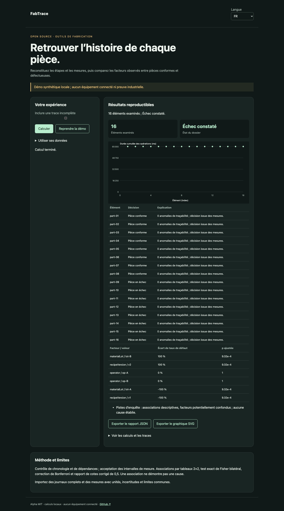

# FabTrace

[Français](README.md) · [English](README.en.md) · [Español](README.es.md)

Reconstituez les étapes et les mesures, puis comparez les facteurs observés entre pièces conformes et défectueuses.



## Essayer en une minute

Node.js 22+ suffit : aucune dépendance d’exécution, aucun compte ni clé API. La démo reste sur la boucle locale. Ouvrir http://127.0.0.1:4321/?lang=fr.

```sh
git clone https://github.com/gbesse/fabtrace.git
cd fabtrace
node bin/cli.js demo --locale=fr
npm start
```

`PORT=4322 npm start` change le port.

## Utiliser ses données

Importer un JSON dans la démo, ou partir de `fixtures/demo.json`. Les raccourcis de réglage concernent uniquement la démo synthétique ; les dossiers importés se modifient dans le JSON. Changer la langue traduit les libellés et rapports, jamais les données ou identifiants. Exports JSON et SVG disponibles. Aucun envoi réseau des données.

```sh
node bin/cli.js run fixtures/demo.json --locale=fr --output=report.json
node bin/cli.js check fixtures/demo.json --locale=fr
```

`--output` crée exclusivement un nouveau fichier en mode 600 et refuse tout écrasement. Les rapports CLI contiennent le SHA-256 des octets d’entrée : intégrité de rejeu, sans preuve d’authenticité. Limite CLI/import : 5 Mo. `run` produit le rapport même si la décision est négative ; `check` retourne 0 (`pass`), 1 (`fail`), 3 (`inconclusive`) ou 2 pour une erreur de format/commande.

## Format JSON v1

Enveloppe requise : `schemaVersion: 1`, `origin: synthetic | user`. L’origine est déclarative ; ce champ n’authentifie pas les mesures. Champs additionnels acceptés comme métadonnées mais ignorés dans les décisions. Les paramètres physiques et protocoles doivent rester dans les champs documentés.

`operations`, `requirements` et `parts` sont requis. Une opération contient `id`, `dependsOn`. Une exigence contient `id`, `operationId`, `metric`, `unit`, `limits: {min, max}`. Une pièce contient `id`, `facts` (facteurs catégoriels de type chaîne), `events` et `measurements`. Un événement contient `id`, `seq`, `operationId`, `type` (`start`/`finish`), `time` UTC ISO et `parameters`. Une mesure contient `id`, `requirementId`, `value`, `uncertainty95`, `unit`. Unités exactes, sans conversion. Limites : 100 opérations, 100 exigences, 500 pièces, 500 événements et mesures par pièce. Une opération est exécutée une seule fois ; les tentatives répétées relèvent de FabResume.

## Comportement et limites

Contrôle de chronologie et de dépendances ; acceptation des intervalles de mesure. Associations par tableaux 2×2, test exact de Fisher bilatéral, correction de Bonferroni et rapport de cotes corrigé de 0,5. Une association ne démontre pas une cause.

La démo contient 16 pièces : 8 conformes et 8 en échec. Lot de matériau et version de recette changent ensemble : ils produisent la même association et ne peuvent pas être distingués causalement. Traces incomplètes et mesures indéterminées sont exclues des associations. Les valeurs absentes ne sont pas assimilées au groupe témoin. Au moins deux pièces exposées et deux non exposées sont requises par comparaison. Les p ajustées couvrent les comparaisons du rapport, pas toutes les analyses possibles. L’indépendance des pièces est supposée ; les lots corrélés peuvent invalider l’interprétation statistique. Aucun connecteur QIF/OPC UA ni diagnostic causal automatique.

## API JavaScript

```js
import { readFile } from 'node:fs/promises';
import { analyze } from './src/index.js';
const input = JSON.parse(await readFile('fixtures/demo.json', 'utf8'));
const report = analyze(input, { locale: 'fr' });
console.log(report.status, report.rows);
```

`analyze` est synchrone, déterministe et ne modifie pas l’entrée. Les résultats sont des copies indépendantes. Les messages sont localisés ; les états et noms de champs sont des identifiants stables.

## Vérifier et contribuer

```sh
npm ci --ignore-scripts
npm test
npx playwright install chromium
npm run test:browser
npm run format:check
```

Tests de décisions et contre-exemples, validation des entrées, codes de sortie, empreintes et exports sans écrasement. Parcours navigateur FR/EN/ES : modification, erreurs, import, changement de langue, exports et mobile. CI sur Node 22 et 24. Contribuer un cas reproductible avec unités, hypothèses, provenance et résultats attendus ; toute évolution publique doit inclure FR/EN/ES.

## État et outils associés

Alpha indépendante sous MIT, non affiliée à Atomic Machines. Exemples et preuves de démonstration synthétiques, aucun équipement ni API industrielle connecté. Dépôt autonome ; pas de publication npm.

[Matter Compiler](https://www.atomicmachines.com/matter-compiler) · [PartCAD](https://github.com/partcad/partcad) · [Bluesky](https://blueskyproject.io/) · [OPC UA Job Management](https://reference.opcfoundation.org/specs/OPC-40001-3/full) · [QIF](https://www.nist.gov/publications/end-end-quality-information-framework-qif-technology-survey)
