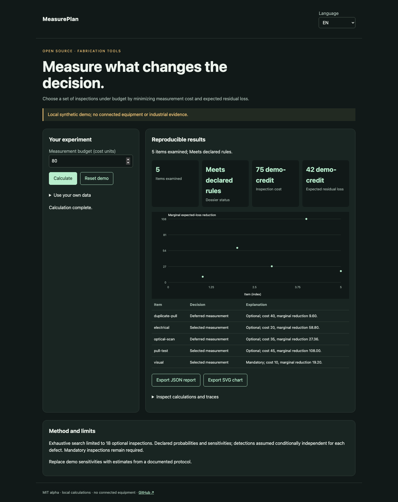

# MeasurePlan

[Français](README.md) · [English](README.en.md) · [Español](README.es.md)

Choose a set of inspections under budget by minimizing measurement cost and expected residual loss.



## Try it in a minute

Node.js 22+ is sufficient: no runtime dependencies, account or API key. The demo stays on loopback. Open http://127.0.0.1:4321/?lang=en.

```sh
git clone https://github.com/gbesse/measureplan.git
cd measureplan
node bin/cli.js demo --locale=en
npm start
```

`PORT=4322 npm start` changes the port.

## Use your own data

Import JSON in the demo, or start from `fixtures/demo.json`. Setting shortcuts apply only to the synthetic demo; imported dossiers are edited in JSON. Language changes labels and reports, never data or identifiers. JSON and SVG exports available. No network transmission of data.

```sh
node bin/cli.js run fixtures/demo.json --locale=en --output=report.json
node bin/cli.js check fixtures/demo.json --locale=en
```

`--output` exclusively creates a new file with mode 600 and refuses overwrites. CLI reports include SHA-256 of input bytes: replay integrity, not authenticity. CLI/import limit: 5 MB. `run` emits the report even for a negative decision; `check` returns 0 (`pass`), 1 (`fail`), 3 (`inconclusive`) or 2 for format/command errors.

## JSON v1 format

Required envelope: `schemaVersion: 1`, `origin: synthetic | user`. Origin is declarative; this field does not authenticate measurements. Additional fields are accepted as metadata but ignored in decisions. Physical parameters and protocols must remain in documented fields.

`budget` and `cost` are nonnegative integers in the same `costUnit`. A risk contains `id`, `probability` (0–1) and `loss` in that unit. A measurement contains `id`, `cost`, `mandatory` and `detection: [{riskId, sensitivity}]` (0–1). Limits: 50 risks, 20 measurements with at most 18 optional. Probabilities, losses and sensitivities are user-supplied; no automatic estimation from results or Bayesian updating.

## Behavior and limits

Exhaustive search limited to 18 optional inspections. Declared probabilities and sensitivities; detections assumed conditionally independent for each defect. Mandatory inspections remain required.

For defect r, residual loss is `probability × loss × product(1 − sensitivity)` over selected inspections. The objective adds their cost. Losses from multiple defects are assumed additive. Budget limits measurement cost only. The demo selects `visual`, `pull-test`, `electrical`: cost 75, residual loss 42, expected total 117 fictional units. Marginal reductions account for already selected inspections. Uncalibrated probabilities and correlated detections can change the optimum.

## JavaScript API

```js
import { readFile } from 'node:fs/promises';
import { analyze } from './src/index.js';
const input = JSON.parse(await readFile('fixtures/demo.json', 'utf8'));
const report = analyze(input, { locale: 'en' });
console.log(report.status, report.rows);
```

`analyze` is synchronous, deterministic and does not mutate input. Results are independent copies. Messages are localized; states and field names are stable identifiers.

## Verify and contribute

```sh
npm ci --ignore-scripts
npm test
npx playwright install chromium
npm run test:browser
npm run format:check
```

Decision tests and counterexamples, input validation, exit codes, hashes and no-overwrite exports. FR/EN/ES browser flows: changes, errors, import, language switching, exports and mobile. CI on Node 22 and 24. Contribute a reproducible case with units, assumptions, provenance and expected results; all public changes must include FR/EN/ES.

## Status and related tools

Independent MIT alpha, not affiliated with Atomic Machines. Synthetic demo examples and evidence, no connected equipment or industrial API. Standalone repository; not published on npm.

[Matter Compiler](https://www.atomicmachines.com/matter-compiler) · [PartCAD](https://github.com/partcad/partcad) · [Bluesky](https://blueskyproject.io/) · [OPC UA Job Management](https://reference.opcfoundation.org/specs/OPC-40001-3/full) · [QIF](https://www.nist.gov/publications/end-end-quality-information-framework-qif-technology-survey)
