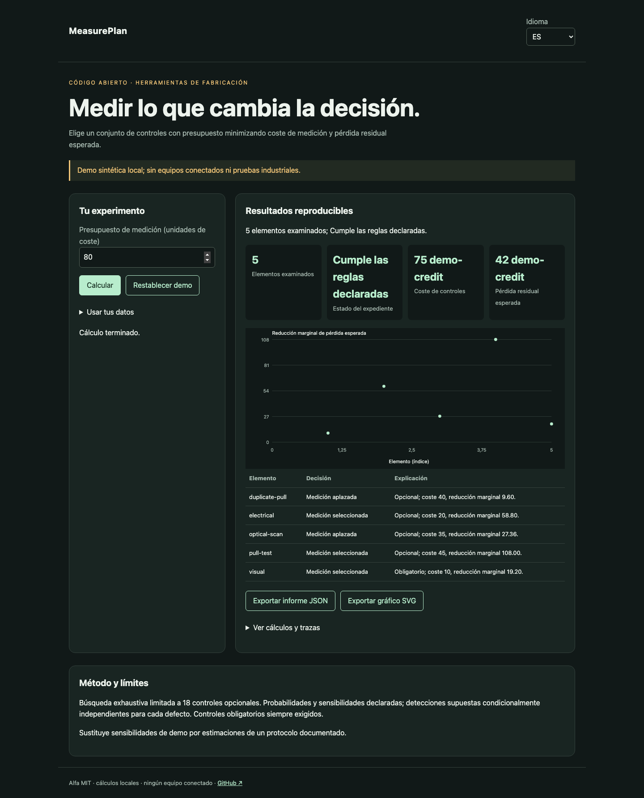

# MeasurePlan

[Français](README.md) · [English](README.en.md) · [Español](README.es.md)

Elige un conjunto de controles con presupuesto minimizando coste de medición y pérdida residual esperada.



## Probar en un minuto

Node.js 22+ basta: sin dependencias de ejecución, cuenta ni clave API. La demo permanece en loopback. Abrir http://127.0.0.1:4321/?lang=es.

```sh
git clone https://github.com/gbesse/measureplan.git
cd measureplan
node bin/cli.js demo --locale=es
npm start
```

`PORT=4322 npm start` cambia el puerto.

## Usar tus datos

Importa JSON en la demo, o parte de `fixtures/demo.json`. Los atajos de ajustes solo afectan la demo sintética; expedientes importados se editan en JSON. Cambiar idioma traduce etiquetas e informes, nunca datos ni identificadores. Exportaciones JSON y SVG disponibles. Sin transmisión de datos por red.

```sh
node bin/cli.js run fixtures/demo.json --locale=es --output=report.json
node bin/cli.js check fixtures/demo.json --locale=es
```

`--output` crea exclusivamente un archivo nuevo con modo 600 y rechaza sobrescrituras. Informes CLI incluyen SHA-256 de bytes de entrada: integridad de reproducción, no autenticidad. Límite CLI/importación: 5 MB. `run` genera informe incluso con decisión negativa; `check` devuelve 0 (`pass`), 1 (`fail`), 3 (`inconclusive`) o 2 para errores de formato/orden.

## Formato JSON v1

Envoltura obligatoria: `schemaVersion: 1`, `origin: synthetic | user`. Origen declarativo; el campo no autentica mediciones. Campos adicionales aceptados como metadatos pero ignorados en decisiones. Parámetros físicos y protocolos deben permanecer en campos documentados.

`budget` y `cost` son enteros no negativos en la misma `costUnit`. Un riesgo contiene `id`, `probability` (0–1) y `loss` en esa unidad. Una medición contiene `id`, `cost`, `mandatory` y `detection: [{riskId, sensitivity}]` (0–1). Límites: 50 riesgos, 20 mediciones con un máximo de 18 opcionales. Probabilidades, pérdidas y sensibilidades aportadas por el usuario; sin estimación automática a partir de resultados ni actualización bayesiana.

## Comportamiento y límites

Búsqueda exhaustiva limitada a 18 controles opcionales. Probabilidades y sensibilidades declaradas; detecciones supuestas condicionalmente independientes para cada defecto. Controles obligatorios siempre exigidos.

Para el defecto r, la pérdida residual es `probability × loss × producto(1 − sensitivity)` sobre controles seleccionados. El objetivo añade su coste. Pérdidas de múltiples defectos supuestas aditivas. El presupuesto limita solo costes de medición. La demo selecciona `visual`, `pull-test`, `electrical`: coste 75, pérdida residual 42, total esperado 117 unidades ficticias. Reducciones marginales consideran controles ya seleccionados. Probabilidades no calibradas y detecciones correlacionadas pueden cambiar el óptimo.

## API JavaScript

```js
import { readFile } from 'node:fs/promises';
import { analyze } from './src/index.js';
const input = JSON.parse(await readFile('fixtures/demo.json', 'utf8'));
const report = analyze(input, { locale: 'es' });
console.log(report.status, report.rows);
```

`analyze` es síncrono, determinista y no modifica entrada. Resultados son copias independientes. Mensajes localizados; estados y nombres de campos son identificadores estables.

## Verificar y contribuir

```sh
npm ci --ignore-scripts
npm test
npx playwright install chromium
npm run test:browser
npm run format:check
```

Pruebas de decisiones y contraejemplos, validación de entrada, códigos de salida, hashes y exportaciones sin sobrescritura. Flujos FR/EN/ES: cambios, errores, importación, idioma, exportaciones y móvil. CI en Node 22 y 24. Contribuye casos reproducibles con unidades, hipótesis, procedencia y resultados esperados; todo cambio público debe incluir FR/EN/ES.

## Estado y herramientas relacionadas

Alfa independiente bajo MIT, sin afiliación a Atomic Machines. Ejemplos y pruebas de demo sintéticos, sin equipos ni API industrial conectados. Repositorio autónomo; no publicado en npm.

[Matter Compiler](https://www.atomicmachines.com/matter-compiler) · [PartCAD](https://github.com/partcad/partcad) · [Bluesky](https://blueskyproject.io/) · [OPC UA Job Management](https://reference.opcfoundation.org/specs/OPC-40001-3/full) · [QIF](https://www.nist.gov/publications/end-end-quality-information-framework-qif-technology-survey)
