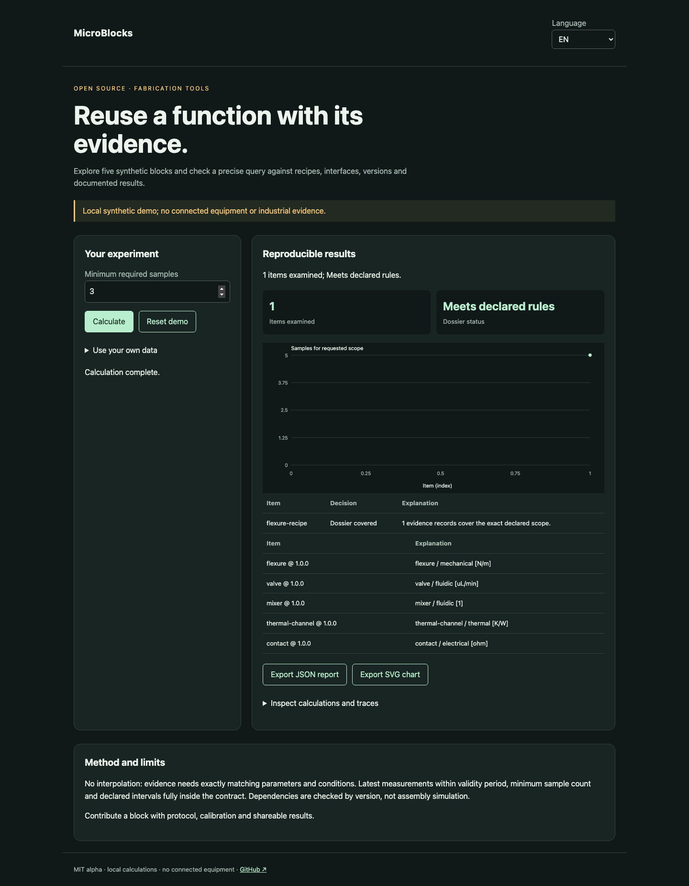

# MicroBlocks

[Français](README.md) · [English](README.en.md) · [Español](README.es.md)

Explore five synthetic blocks and check a precise query against recipes, interfaces, versions and documented results.



## Try it in a minute

Node.js 22+ is sufficient: no runtime dependencies, account or API key. The demo stays on loopback. Open http://127.0.0.1:4321/?lang=en.

```sh
git clone https://github.com/gbesse/microblocks.git
cd microblocks
node bin/cli.js demo --locale=en
npm start
```

`PORT=4322 npm start` changes the port.

## Use your own data

Import JSON in the demo, or start from `fixtures/demo.json`. Setting shortcuts apply only to the synthetic demo; imported dossiers are edited in JSON. Language changes labels and reports, never data or identifiers. JSON and SVG exports available. No network transmission of data.

```sh
node bin/cli.js run fixtures/demo.json --locale=en --output=report.json
node bin/cli.js check fixtures/demo.json --locale=en
```

`--output` exclusively creates a new file with mode 600 and refuses overwrites. CLI reports include SHA-256 of input bytes: replay integrity, not authenticity. CLI/import limit: 5 MB. `run` emits the report even for a negative decision; `check` returns 0 (`pass`), 1 (`fail`), 3 (`inconclusive`) or 2 for format/command errors.

## JSON v1 format

Required envelope: `schemaVersion: 1`, `origin: synthetic | user`. Origin is declarative; this field does not authenticate measurements. Additional fields are accepted as metadata but ignored in decisions. Physical parameters and protocols must remain in documented fields.

`asOf`, `blocks` and `query` are required. A block contains `id`, numeric `x.y.z` `version`, `function`, `interfaces: [{id, domain, unit}]`, `requires: [{blockId, version}]`, `metrics: {name: {min, max, unit}}`, `design: {format, file, units, illustrative, sha256}`, `recipes` and `evidence`. Geometry files are relative `fixtures/*.scad` or `*.step` references, in mm. The core validates the reference and declared digest without reading or authenticating the file. A recipe contains `id`, `profileId`, `parameters` and `conditions`, each a range object `{min, max, unit}`. The query contains `blockId`, `version`, `profileId`, `minimumSamples`, `parameters` and `conditions` with quantities `{value, unit}`. Evidence contains `id`, `recipeId`, `version`, `origin`, `basis` from `basisFor(block, recipeId)`, measured parameters and conditions, `samples`, `measuredAt`, `validUntil`, `provenance: {protocolId, instrument, calibrationId}` and `metrics: {name: {value, uncertainty95, unit}}`. Limits: 100 blocks, 100 recipes and 500 evidence records per block.

## Behavior and limits

No interpolation: evidence needs exactly matching parameters and conditions. Latest measurements within validity period, minimum sample count and declared intervals fully inside the contract. Dependencies are checked by version, not assembly simulation.

The catalog includes a flexure, valve housing, mixer, thermal channel and contact with illustrative OpenSCAD sources. `designFor(id, {scale})` produces those sources for scale 0.8–1.2. Illustrative geometry and synthetic measurements are separate: no valve, mixing or contact function is validated by these shapes. Evidence requires the same block and recipe `basis`; changing the digest, contract or recipe invalidates it. `uncertainty95` is a supplied half-width, without statistical estimation. Synthetic data cannot cover an `origin: user` query. Dependencies are checked by version; no assembly is qualified.

## JavaScript API

```js
import { readFile } from 'node:fs/promises';
import { analyze } from './src/index.js';
const input = JSON.parse(await readFile('fixtures/demo.json', 'utf8'));
const report = analyze(input, { locale: 'en' });
console.log(report.status, report.rows);
```

`analyze` is synchronous, deterministic and does not mutate input. Results are independent copies. Messages are localized; states and field names are stable identifiers.

## Verify and contribute

```sh
npm ci --ignore-scripts
npm test
npx playwright install chromium
npm run test:browser
npm run format:check
```

Decision tests and counterexamples, input validation, exit codes, hashes and no-overwrite exports. FR/EN/ES browser flows: changes, errors, import, language switching, exports and mobile. CI on Node 22 and 24. Contribute a reproducible case with units, assumptions, provenance and expected results; all public changes must include FR/EN/ES.

## Status and related tools

Independent MIT alpha, not affiliated with Atomic Machines. Synthetic demo examples and evidence, no connected equipment or industrial API. Standalone repository; not published on npm.

[Matter Compiler](https://www.atomicmachines.com/matter-compiler) · [PartCAD](https://github.com/partcad/partcad) · [Bluesky](https://blueskyproject.io/) · [OPC UA Job Management](https://reference.opcfoundation.org/specs/OPC-40001-3/full) · [QIF](https://www.nist.gov/publications/end-end-quality-information-framework-qif-technology-survey)
