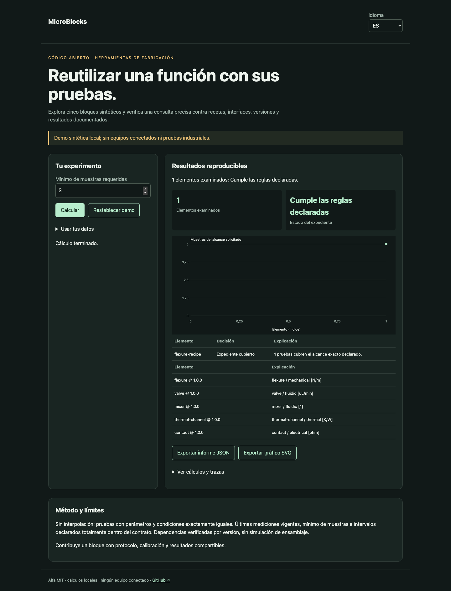

# MicroBlocks

[Français](README.md) · [English](README.en.md) · [Español](README.es.md)

Explora cinco bloques sintéticos y verifica una consulta precisa contra recetas, interfaces, versiones y resultados documentados.



## Probar en un minuto

Node.js 22+ basta: sin dependencias de ejecución, cuenta ni clave API. La demo permanece en loopback. Abrir http://127.0.0.1:4321/?lang=es.

```sh
git clone https://github.com/gbesse/microblocks.git
cd microblocks
node bin/cli.js demo --locale=es
npm start
```

`PORT=4322 npm start` cambia el puerto.

## Usar tus datos

Importa JSON en la demo, o parte de `fixtures/demo.json`. Los atajos de ajustes solo afectan la demo sintética; expedientes importados se editan en JSON. Cambiar idioma traduce etiquetas e informes, nunca datos ni identificadores. Exportaciones JSON y SVG disponibles. Sin transmisión de datos por red.

```sh
node bin/cli.js run fixtures/demo.json --locale=es --output=report.json
node bin/cli.js check fixtures/demo.json --locale=es
```

`--output` crea exclusivamente un archivo nuevo con modo 600 y rechaza sobrescrituras. Informes CLI incluyen SHA-256 de bytes de entrada: integridad de reproducción, no autenticidad. Límite CLI/importación: 5 MB. `run` genera informe incluso con decisión negativa; `check` devuelve 0 (`pass`), 1 (`fail`), 3 (`inconclusive`) o 2 para errores de formato/orden.

## Formato JSON v1

Envoltura obligatoria: `schemaVersion: 1`, `origin: synthetic | user`. Origen declarativo; el campo no autentica mediciones. Campos adicionales aceptados como metadatos pero ignorados en decisiones. Parámetros físicos y protocolos deben permanecer en campos documentados.

`asOf`, `blocks` y `query` son obligatorios. Un bloque contiene `id`, `version` numérica `x.y.z`, `function`, `interfaces: [{id, domain, unit}]`, `requires: [{blockId, version}]`, `metrics: {nombre: {min, max, unit}}`, `design: {format, file, units, illustrative, sha256}`, `recipes` y `evidence`. Los archivos geométricos son referencias relativas `fixtures/*.scad` o `*.step`, en mm. El núcleo valida referencia y digest declarado sin leer ni autenticar el archivo. Una receta contiene `id`, `profileId`, `parameters` y `conditions`, cada uno un objeto de rangos `{min, max, unit}`. La consulta contiene `blockId`, `version`, `profileId`, `minimumSamples`, `parameters` y `conditions` con cantidades `{value, unit}`. Una prueba contiene `id`, `recipeId`, `version`, `origin`, `basis` de `basisFor(block, recipeId)`, parámetros y condiciones medidos, `samples`, `measuredAt`, `validUntil`, `provenance: {protocolId, instrument, calibrationId}` y `metrics: {nombre: {value, uncertainty95, unit}}`. Límites: 100 bloques, 100 recetas y 500 pruebas por bloque.

## Comportamiento y límites

Sin interpolación: pruebas con parámetros y condiciones exactamente iguales. Últimas mediciones vigentes, mínimo de muestras e intervalos declarados totalmente dentro del contrato. Dependencias verificadas por versión, sin simulación de ensamblaje.

El catálogo incluye flexura, alojamiento de válvula, mezclador, canal térmico y contacto con fuentes OpenSCAD ilustrativas. `designFor(id, {scale})` genera esas fuentes para escala 0,8–1,2. Geometría ilustrativa y mediciones sintéticas están separadas: estas formas no validan funciones de válvula, mezcla o contacto. La prueba requiere el mismo `basis` de bloque y receta; cambiar digest, contrato o receta la invalida. `uncertainty95` es una semianchura aportada, sin estimación estadística. Datos sintéticos no cubren consultas `origin: user`. Dependencias comprobadas por versión; ningún ensamblaje cualificado.

## API JavaScript

```js
import { readFile } from 'node:fs/promises';
import { analyze } from './src/index.js';
const input = JSON.parse(await readFile('fixtures/demo.json', 'utf8'));
const report = analyze(input, { locale: 'es' });
console.log(report.status, report.rows);
```

`analyze` es síncrono, determinista y no modifica entrada. Resultados son copias independientes. Mensajes localizados; estados y nombres de campos son identificadores estables.

## Verificar y contribuir

```sh
npm ci --ignore-scripts
npm test
npx playwright install chromium
npm run test:browser
npm run format:check
```

Pruebas de decisiones y contraejemplos, validación de entrada, códigos de salida, hashes y exportaciones sin sobrescritura. Flujos FR/EN/ES: cambios, errores, importación, idioma, exportaciones y móvil. CI en Node 22 y 24. Contribuye casos reproducibles con unidades, hipótesis, procedencia y resultados esperados; todo cambio público debe incluir FR/EN/ES.

## Estado y herramientas relacionadas

Alfa independiente bajo MIT, sin afiliación a Atomic Machines. Ejemplos y pruebas de demo sintéticos, sin equipos ni API industrial conectados. Repositorio autónomo; no publicado en npm.

[Matter Compiler](https://www.atomicmachines.com/matter-compiler) · [PartCAD](https://github.com/partcad/partcad) · [Bluesky](https://blueskyproject.io/) · [OPC UA Job Management](https://reference.opcfoundation.org/specs/OPC-40001-3/full) · [QIF](https://www.nist.gov/publications/end-end-quality-information-framework-qif-technology-survey)
