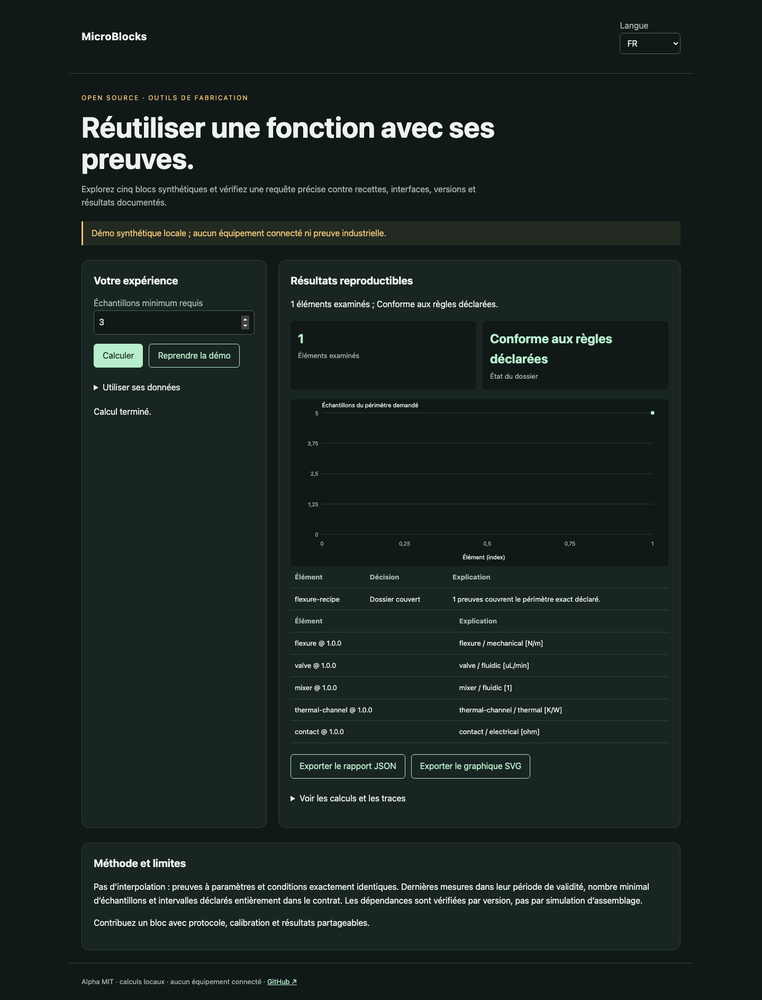

# MicroBlocks

[Français](README.md) · [English](README.en.md) · [Español](README.es.md)

Explorez cinq blocs synthétiques et vérifiez une requête précise contre recettes, interfaces, versions et résultats documentés.



## Essayer en une minute

Node.js 22+ suffit : aucune dépendance d’exécution, aucun compte ni clé API. La démo reste sur la boucle locale. Ouvrir http://127.0.0.1:4321/?lang=fr.

```sh
git clone https://github.com/gbesse/microblocks.git
cd microblocks
node bin/cli.js demo --locale=fr
npm start
```

`PORT=4322 npm start` change le port.

## Utiliser ses données

Importer un JSON dans la démo, ou partir de `fixtures/demo.json`. Les raccourcis de réglage concernent uniquement la démo synthétique ; les dossiers importés se modifient dans le JSON. Changer la langue traduit les libellés et rapports, jamais les données ou identifiants. Exports JSON et SVG disponibles. Aucun envoi réseau des données.

```sh
node bin/cli.js run fixtures/demo.json --locale=fr --output=report.json
node bin/cli.js check fixtures/demo.json --locale=fr
```

`--output` crée exclusivement un nouveau fichier en mode 600 et refuse tout écrasement. Les rapports CLI contiennent le SHA-256 des octets d’entrée : intégrité de rejeu, sans preuve d’authenticité. Limite CLI/import : 5 Mo. `run` produit le rapport même si la décision est négative ; `check` retourne 0 (`pass`), 1 (`fail`), 3 (`inconclusive`) ou 2 pour une erreur de format/commande.

## Format JSON v1

Enveloppe requise : `schemaVersion: 1`, `origin: synthetic | user`. L’origine est déclarative ; ce champ n’authentifie pas les mesures. Champs additionnels acceptés comme métadonnées mais ignorés dans les décisions. Les paramètres physiques et protocoles doivent rester dans les champs documentés.

`asOf`, `blocks` et `query` sont requis. Un bloc contient `id`, `version` numérique `x.y.z`, `function`, `interfaces: [{id, domain, unit}]`, `requires: [{blockId, version}]`, `metrics: {nom: {min, max, unit}}`, `design: {format, file, units, illustrative, sha256}`, `recipes` et `evidence`. Les fichiers de géométrie sont des références relatives `fixtures/*.scad` ou `*.step`, en mm. Le cœur valide la référence et le digest déclaré, sans lire ni authentifier le fichier. Une recette contient `id`, `profileId`, `parameters` et `conditions`, chacun un objet de plages `{min, max, unit}`. La requête contient `blockId`, `version`, `profileId`, `minimumSamples`, `parameters` et `conditions` avec valeurs `{value, unit}`. Une preuve contient `id`, `recipeId`, `version`, `origin`, `basis` issu de `basisFor(block, recipeId)`, les paramètres et conditions mesurés, `samples`, `measuredAt`, `validUntil`, `provenance: {protocolId, instrument, calibrationId}` et `metrics: {nom: {value, uncertainty95, unit}}`. Limites : 100 blocs, 100 recettes et 500 preuves par bloc.

## Comportement et limites

Pas d’interpolation : preuves à paramètres et conditions exactement identiques. Dernières mesures dans leur période de validité, nombre minimal d’échantillons et intervalles déclarés entièrement dans le contrat. Les dépendances sont vérifiées par version, pas par simulation d’assemblage.

Le catalogue contient une flexure, un logement de valve, un mélangeur, un canal thermique et un contact, avec sources OpenSCAD illustratives. `designFor(id, {scale})` produit ces sources pour une échelle de 0,8 à 1,2. Géométrie illustrative et mesures synthétiques sont séparées : aucune fonction de valve, de mélange ou de contact n’est validée par ces formes. Une preuve exige le même `basis` de bloc et recette ; modifier le digest, le contrat ou la recette l’invalide. `uncertainty95` est une demi-largeur fournie, sans calcul statistique. Une donnée synthétique ne couvre pas une requête `origin: user`. Les dépendances sont contrôlées par version ; aucun assemblage n’est qualifié.

## API JavaScript

```js
import { readFile } from 'node:fs/promises';
import { analyze } from './src/index.js';
const input = JSON.parse(await readFile('fixtures/demo.json', 'utf8'));
const report = analyze(input, { locale: 'fr' });
console.log(report.status, report.rows);
```

`analyze` est synchrone, déterministe et ne modifie pas l’entrée. Les résultats sont des copies indépendantes. Les messages sont localisés ; les états et noms de champs sont des identifiants stables.

## Vérifier et contribuer

```sh
npm ci --ignore-scripts
npm test
npx playwright install chromium
npm run test:browser
npm run format:check
```

Tests de décisions et contre-exemples, validation des entrées, codes de sortie, empreintes et exports sans écrasement. Parcours navigateur FR/EN/ES : modification, erreurs, import, changement de langue, exports et mobile. CI sur Node 22 et 24. Contribuer un cas reproductible avec unités, hypothèses, provenance et résultats attendus ; toute évolution publique doit inclure FR/EN/ES.

## État et outils associés

Alpha indépendante sous MIT, non affiliée à Atomic Machines. Exemples et preuves de démonstration synthétiques, aucun équipement ni API industrielle connecté. Dépôt autonome ; pas de publication npm.

[Matter Compiler](https://www.atomicmachines.com/matter-compiler) · [PartCAD](https://github.com/partcad/partcad) · [Bluesky](https://blueskyproject.io/) · [OPC UA Job Management](https://reference.opcfoundation.org/specs/OPC-40001-3/full) · [QIF](https://www.nist.gov/publications/end-end-quality-information-framework-qif-technology-survey)
