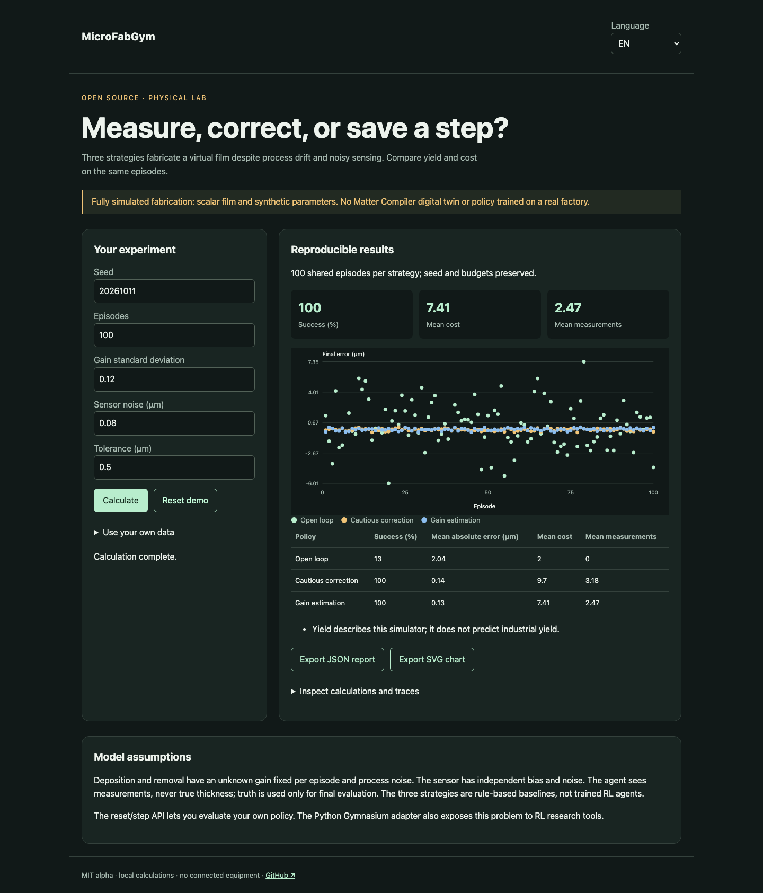

# MicroFabGym

[Français](README.md) · English · [Español](README.es.md)

A partially observable fabrication environment for testing when to measure and how to correct deposition.



## Try it in a minute

Node.js 22+ is sufficient for calculations and the demo. No account or API key. Open http://127.0.0.1:4321/?lang=en. `PORT=4322 npm start` changes the port; loopback only.

```sh
git clone https://github.com/gbesse/microfabgym.git
cd microfabgym
node bin/cli.js demo --locale=en
npm start
```

## Use your own data

The `fixtures/` directory contains examples. The interface accepts a file or edited JSON and exports JSON reports and SVG charts. Language changes labels, never user data or identifiers. CLI exports use exclusive `--output=new-file` creation and never overwrite existing files. Each CLI report includes SHA-256 hashes of input bytes; these do not establish measurement authenticity.

The Gymnasium adapter communicates with the same Node engine over JSON without duplicating physics. Python 3.10+; the first action component selects finish/measure/deposit/remove, the second sets magnitude up to 2 × target.

```sh
node bin/cli.js run fixtures/demo.json --locale=en
```

Optional adapter: `python3 -m venv .venv`, `.venv/bin/pip install -r python/requirements.txt`, `.venv/bin/python python/smoke.py`. Node calculations and demo do not require Python.

## Method and limitations

Scalar thickness, deposition/removal with unknown per-episode gain, process noise, sensor bias and noise. Deterministic seed; physical and sensor random streams are separated so an extra measurement does not change fabrication drift. Bounded budget and step count. Three rule-based policies: open loop, cautious correction, gain estimation. No RL training performed.

`reset()` and `step({ type, amountUm })` expose only target, last measurement and budgets. Actions: `deposit`, `remove`, `measure`, `finish`. Ground truth is used for evaluation after termination. `runPolicy(config, callback, episode)` accepts a custom policy receiving observations only. `benchmarkPolicies()` compares three baselines on the same episodes. Target, tolerance and noise in µm; costs in abstract units. Yield is not an industrial prediction.

## Verify

Tests check physical or statistical laws, invalid inputs, exports and browser flows in all three languages.

```sh
npm ci
npm test
npx playwright install chromium
npm run test:browser
npm run format:check
```

## Next evidence sought

Calibrate one process on physical measurements, then publish test episodes outside the training distribution.

## Status and contribution

Independent MIT alpha, not affiliated with Atomic Machines. No access to their hardware or API. Not published on npm. Demo fixtures are synthetic. Contribute a reproducible case with assumptions, units and expected results; publish only data you are authorized to share.

## Sources and related tools

[Bluesky Adaptive](https://blueskyproject.io/bluesky-adaptive/) · [LineFlow](https://github.com/hs-kempten/lineflow) · [Gymnasium](https://gymnasium.farama.org/)
