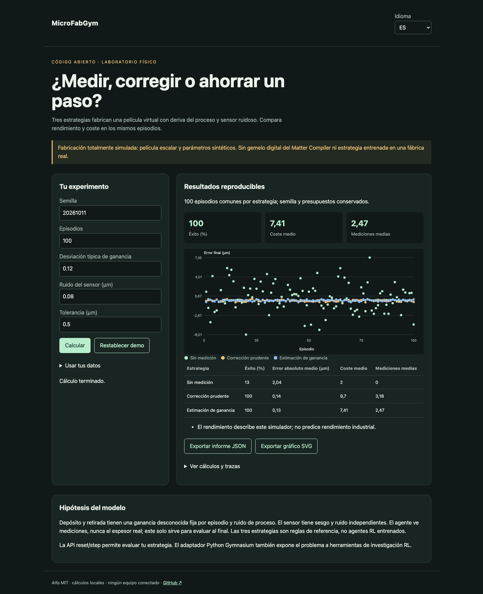

# MicroFabGym

[Français](README.md) · [English](README.en.md) · Español

Un entorno de fabricación parcialmente observable para probar cuándo medir y cómo corregir un depósito.



## Probar en un minuto

Node.js 22+ basta para los cálculos y la demo. Sin cuenta ni clave API. Abrir http://127.0.0.1:4321/?lang=es. `PORT=4322 npm start` cambia el puerto; solo escucha local.

```sh
git clone https://github.com/gbesse/microfabgym.git
cd microfabgym
node bin/cli.js demo --locale=es
npm start
```

## Usar tus datos

El directorio `fixtures/` contiene ejemplos. La interfaz acepta archivos o JSON editado y exporta informes JSON y gráficos SVG. El idioma cambia etiquetas, nunca datos del usuario ni identificadores. Las exportaciones CLI se crean exclusivamente con `--output=archivo-nuevo` y no sobrescriben archivos existentes. Cada informe CLI incluye hashes SHA-256 de los bytes de entrada; no prueban la autenticidad de las mediciones.

El adaptador Gymnasium se comunica con el mismo motor Node por JSON sin duplicar física. Python 3.10+; la primera componente de acción elige terminar/medir/depositar/retirar y la segunda fija cantidad hasta 2 × objetivo.

```sh
node bin/cli.js run fixtures/demo.json --locale=es
```

Adaptador opcional: `python3 -m venv .venv`, `.venv/bin/pip install -r python/requirements.txt`, `.venv/bin/python python/smoke.py`. Los cálculos Node y la demo no requieren Python.

## Método y límites

Espesor escalar, depósito/retirada con ganancia desconocida por episodio, ruido de proceso, sesgo y ruido del sensor. Semilla determinista; flujos aleatorios físicos y de medición separados para que medir más no cambie la deriva. Presupuesto y pasos limitados. Tres estrategias de reglas: sin medición, corrección prudente, estimación de ganancia. Sin entrenamiento RL.

`reset()` y `step({ type, amountUm })` exponen solo objetivo, última medición y presupuestos. Acciones: `deposit`, `remove`, `measure`, `finish`. La verdad de referencia evalúa el resultado tras terminar. `runPolicy(config, callback, episode)` acepta una estrategia que recibe solo observaciones. `benchmarkPolicies()` compara tres referencias sobre los mismos episodios. Objetivo, tolerancia y ruido en µm; costes en unidades abstractas. El rendimiento no predice una fábrica real.

## Verificar

Los tests comprueban leyes físicas o estadísticas, entradas no válidas, exportaciones y recorridos del navegador en los tres idiomas.

```sh
npm ci
npm test
npx playwright install chromium
npm run test:browser
npm run format:check
```

## Siguiente prueba buscada

Calibrar un proceso con mediciones físicas y publicar episodios de prueba fuera de la distribución de entrenamiento.

## Estado y contribución

Alfa independiente con licencia MIT, sin afiliación con Atomic Machines. Sin acceso a su hardware ni API. No publicado en npm. Los ejemplos son sintéticos. Contribuye un caso reproducible con hipótesis, unidades y resultados esperados; publica solo datos que estés autorizado a compartir.

## Fuentes y herramientas relacionadas

[Bluesky Adaptive](https://blueskyproject.io/bluesky-adaptive/) · [LineFlow](https://github.com/hs-kempten/lineflow) · [Gymnasium](https://gymnasium.farama.org/)
