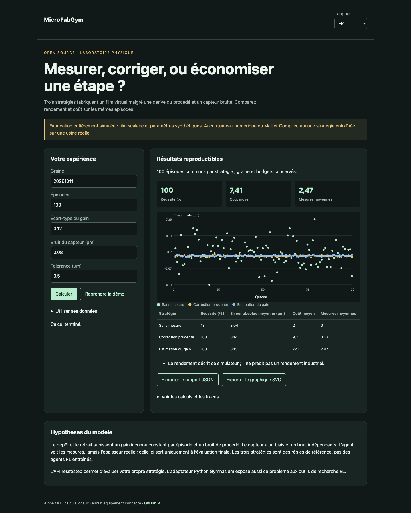

# MicroFabGym

Français · [English](README.en.md) · [Español](README.es.md)

Un environnement de fabrication partiellement observable pour tester quand mesurer et comment corriger un dépôt.



## Essayer en une minute

Node.js 22+ suffit pour les calculs et la démo. Aucun compte, aucune clé API. Ouvrir http://127.0.0.1:4321/?lang=fr. `PORT=4322 npm start` change le port ; écoute locale uniquement.

```sh
git clone https://github.com/gbesse/microfabgym.git
cd microfabgym
node bin/cli.js demo --locale=fr
npm start
```

## Utiliser ses données

Le dossier `fixtures/` contient les exemples. L’interface accepte un fichier ou un JSON édité et exporte le rapport JSON et le graphique SVG. La langue change les libellés, jamais les données utilisateur ni les identifiants. Les exports CLI sont créés exclusivement avec `--output=nouveau-fichier` et n’écrasent aucun fichier existant. Chaque rapport CLI contient l’empreinte SHA-256 des octets d’entrée ; elle ne prouve pas l’authenticité des mesures.

L’adaptateur Gymnasium communique avec le même moteur Node par JSON, sans dupliquer la physique. Python 3.10+ ; la première composante de l’action choisit finir/mesurer/déposer/retirer, la seconde règle la quantité jusqu’à 2 × la cible.

```sh
node bin/cli.js run fixtures/demo.json --locale=fr
```

Adaptateur optionnel : `python3 -m venv .venv`, `.venv/bin/pip install -r python/requirements.txt`, `.venv/bin/python python/smoke.py`. Les calculs Node et la démo n’exigent pas Python.

## Méthode et limites

Épaisseur scalaire, dépôt/retrait avec gain inconnu constant par épisode, bruit de procédé, biais et bruit de capteur. Graine déterministe ; les flux aléatoires physiques et de mesure sont séparés afin qu’une mesure supplémentaire ne change pas la dérive de fabrication. Budget et nombre d’étapes bornés. Trois stratégies à règles : sans mesure, correction prudente, estimation du gain. Aucun apprentissage RL réalisé.

`reset()` et `step({ type, amountUm })` exposent seulement la cible, la dernière mesure et les budgets. Actions : `deposit`, `remove`, `measure`, `finish`. La vérité terrain sert à l’évaluation après terminaison. `runPolicy(config, callback, episode)` permet une stratégie utilisateur recevant seulement les observations. `benchmarkPolicies()` compare les trois références sur les mêmes épisodes. Tolérance, cible et bruit en µm ; coûts en unités abstraites. Le rendement n’est pas une prédiction industrielle.

## Vérifier

Les tests vérifient les lois physiques ou statistiques, les entrées invalides, les exports et les parcours navigateur dans les trois langues.

```sh
npm ci
npm test
npx playwright install chromium
npm run test:browser
npm run format:check
```

## Prochaine preuve recherchée

Calibrer un seul procédé sur des mesures physiques, puis publier des épisodes de test hors de la distribution d’entraînement.

## Statut et contribution

Alpha indépendante, licence MIT, sans affiliation avec Atomic Machines. Aucun accès à leur matériel ou à leur API. Aucun package publié sur npm. Les fichiers de démonstration sont synthétiques. Contribuer avec un cas reproductible, les hypothèses, les unités et les résultats attendus ; ne publier que des données que vous êtes autorisé à partager.

## Sources et outils voisins

[Bluesky Adaptive](https://blueskyproject.io/bluesky-adaptive/) · [LineFlow](https://github.com/hs-kempten/lineflow) · [Gymnasium](https://gymnasium.farama.org/)
