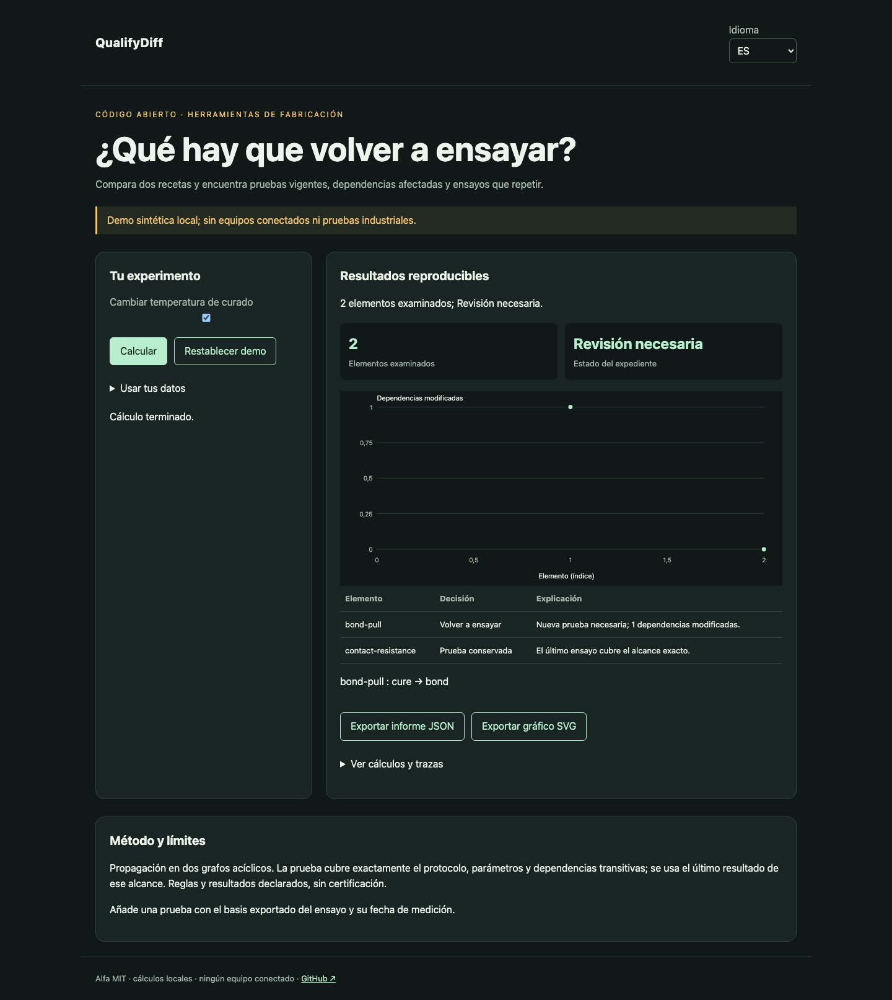

# QualifyDiff

[Français](README.md) · [English](README.en.md) · [Español](README.es.md)

Compara dos recetas y encuentra pruebas vigentes, dependencias afectadas y ensayos que repetir.



## Probar en un minuto

Node.js 22+ basta: sin dependencias de ejecución, cuenta ni clave API. La demo permanece en loopback. Abrir http://127.0.0.1:4321/?lang=es.

```sh
git clone https://github.com/gbesse/qualifydiff.git
cd qualifydiff
node bin/cli.js demo --locale=es
npm start
```

`PORT=4322 npm start` cambia el puerto.

## Usar tus datos

Importa JSON en la demo, o parte de `fixtures/demo.json`. Los atajos de ajustes solo afectan la demo sintética; expedientes importados se editan en JSON. Cambiar idioma traduce etiquetas e informes, nunca datos ni identificadores. Exportaciones JSON y SVG disponibles. Sin transmisión de datos por red.

```sh
node bin/cli.js run fixtures/demo.json --locale=es --output=report.json
node bin/cli.js check fixtures/demo.json --locale=es
```

`--output` crea exclusivamente un archivo nuevo con modo 600 y rechaza sobrescrituras. Informes CLI incluyen SHA-256 de bytes de entrada: integridad de reproducción, no autenticidad. Límite CLI/importación: 5 MB. `run` genera informe incluso con decisión negativa; `check` devuelve 0 (`pass`), 1 (`fail`), 3 (`inconclusive`) o 2 para errores de formato/orden.

## Formato JSON v1

Envoltura obligatoria: `schemaVersion: 1`, `origin: synthetic | user`. Origen declarativo; el campo no autentica mediciones. Campos adicionales aceptados como metadatos pero ignorados en decisiones. Parámetros físicos y protocolos deben permanecer en campos documentados.

`asOf` es una fecha UTC ISO. `baseline` y `candidate` contienen `id`, `nodes` y `tests`. Un nodo contiene `id`, `kind` (`material`, `operation`, `property`), `dependsOn` y `config`. Un ensayo contiene `id`, `dependsOn`, `protocol` y `mandatory`. `evidence` contiene `id`, `testId`, `result` (`pass`/`fail`), `measuredAt` y `basis`. Crear este último con `basisFor(revision, testId)`. Límites: 500 nodos y 200 ensayos por revisión; identificadores únicos, referencias existentes y grafo acíclico.

## Comportamiento y límites

Propagación en dos grafos acíclicos. La prueba cubre exactamente el protocolo, parámetros y dependencias transitivas; se usa el último resultado de ese alcance. Reglas y resultados declarados, sin certificación.

La demo cambia curado de 120 a 130 °C: `bond-pull` necesita repetición, `contact-resistance` conserva su prueba. Los caminos del grafo anterior también explican dependencias eliminadas. Cambios sin cobertura y eliminación de ensayos obligatorios requieren revisión. Prevalece el último resultado del alcance exacto; resultados contradictorios en la misma fecha fallan. Los ensayos declarados no demuestran cobertura de todas las propiedades físicas. `basis` es un objeto canónico, no una firma criptográfica.

## API JavaScript

```js
import { readFile } from 'node:fs/promises';
import { analyze } from './src/index.js';
const input = JSON.parse(await readFile('fixtures/demo.json', 'utf8'));
const report = analyze(input, { locale: 'es' });
console.log(report.status, report.rows);
```

`analyze` es síncrono, determinista y no modifica entrada. Resultados son copias independientes. Mensajes localizados; estados y nombres de campos son identificadores estables.

## Verificar y contribuir

```sh
npm ci --ignore-scripts
npm test
npx playwright install chromium
npm run test:browser
npm run format:check
```

Pruebas de decisiones y contraejemplos, validación de entrada, códigos de salida, hashes y exportaciones sin sobrescritura. Flujos FR/EN/ES: cambios, errores, importación, idioma, exportaciones y móvil. CI en Node 22 y 24. Contribuye casos reproducibles con unidades, hipótesis, procedencia y resultados esperados; todo cambio público debe incluir FR/EN/ES.

## Estado y herramientas relacionadas

Alfa independiente bajo MIT, sin afiliación a Atomic Machines. Ejemplos y pruebas de demo sintéticos, sin equipos ni API industrial conectados. Repositorio autónomo; no publicado en npm.

[Matter Compiler](https://www.atomicmachines.com/matter-compiler) · [PartCAD](https://github.com/partcad/partcad) · [Bluesky](https://blueskyproject.io/) · [OPC UA Job Management](https://reference.opcfoundation.org/specs/OPC-40001-3/full) · [QIF](https://www.nist.gov/publications/end-end-quality-information-framework-qif-technology-survey)
