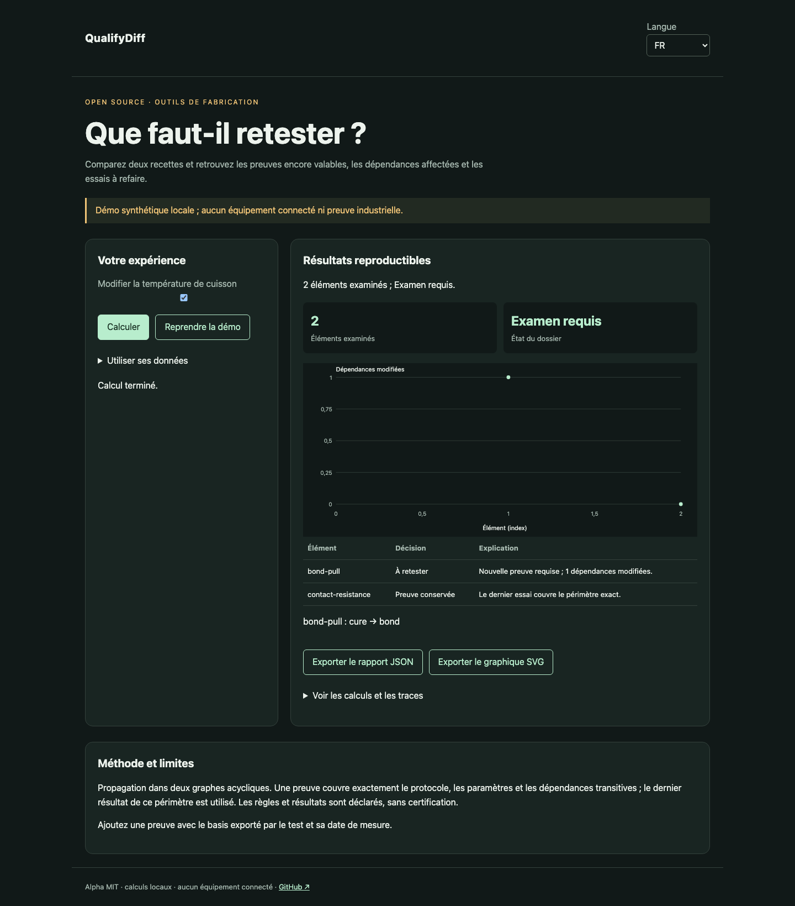

# QualifyDiff

[Français](README.md) · [English](README.en.md) · [Español](README.es.md)

Comparez deux recettes et retrouvez les preuves encore valables, les dépendances affectées et les essais à refaire.



## Essayer en une minute

Node.js 22+ suffit : aucune dépendance d’exécution, aucun compte ni clé API. La démo reste sur la boucle locale. Ouvrir http://127.0.0.1:4321/?lang=fr.

```sh
git clone https://github.com/gbesse/qualifydiff.git
cd qualifydiff
node bin/cli.js demo --locale=fr
npm start
```

`PORT=4322 npm start` change le port.

## Utiliser ses données

Importer un JSON dans la démo, ou partir de `fixtures/demo.json`. Les raccourcis de réglage concernent uniquement la démo synthétique ; les dossiers importés se modifient dans le JSON. Changer la langue traduit les libellés et rapports, jamais les données ou identifiants. Exports JSON et SVG disponibles. Aucun envoi réseau des données.

```sh
node bin/cli.js run fixtures/demo.json --locale=fr --output=report.json
node bin/cli.js check fixtures/demo.json --locale=fr
```

`--output` crée exclusivement un nouveau fichier en mode 600 et refuse tout écrasement. Les rapports CLI contiennent le SHA-256 des octets d’entrée : intégrité de rejeu, sans preuve d’authenticité. Limite CLI/import : 5 Mo. `run` produit le rapport même si la décision est négative ; `check` retourne 0 (`pass`), 1 (`fail`), 3 (`inconclusive`) ou 2 pour une erreur de format/commande.

## Format JSON v1

Enveloppe requise : `schemaVersion: 1`, `origin: synthetic | user`. L’origine est déclarative ; ce champ n’authentifie pas les mesures. Champs additionnels acceptés comme métadonnées mais ignorés dans les décisions. Les paramètres physiques et protocoles doivent rester dans les champs documentés.

`asOf` est une date UTC ISO. `baseline` et `candidate` contiennent `id`, `nodes` et `tests`. Un nœud contient `id`, `kind` (`material`, `operation`, `property`), `dependsOn` et `config`. Un test contient `id`, `dependsOn`, `protocol` et `mandatory`. `evidence` contient `id`, `testId`, `result` (`pass`/`fail`), `measuredAt` et `basis`. Créer ce dernier avec `basisFor(revision, testId)`. Limites : 500 nœuds et 200 tests par révision ; identifiants uniques, références existantes, graphe acyclique.

## Comportement et limites

Propagation dans deux graphes acycliques. Une preuve couvre exactement le protocole, les paramètres et les dépendances transitives ; le dernier résultat de ce périmètre est utilisé. Les règles et résultats sont déclarés, sans certification.

La démo passe la cuisson de 120 à 130 °C : `bond-pull` doit être refait, `contact-resistance` conserve sa preuve. Les chemins du graphe précédent expliquent aussi les dépendances supprimées. Un changement non couvert par un test et la suppression d’un test obligatoire imposent un examen. Le dernier résultat du périmètre exact prévaut ; deux résultats contradictoires à la même date donnent un échec. Aucun test déclaré ne prouve la couverture de toutes les propriétés physiques. `basis` est un objet canonique, pas une signature cryptographique.

## API JavaScript

```js
import { readFile } from 'node:fs/promises';
import { analyze } from './src/index.js';
const input = JSON.parse(await readFile('fixtures/demo.json', 'utf8'));
const report = analyze(input, { locale: 'fr' });
console.log(report.status, report.rows);
```

`analyze` est synchrone, déterministe et ne modifie pas l’entrée. Les résultats sont des copies indépendantes. Les messages sont localisés ; les états et noms de champs sont des identifiants stables.

## Vérifier et contribuer

```sh
npm ci --ignore-scripts
npm test
npx playwright install chromium
npm run test:browser
npm run format:check
```

Tests de décisions et contre-exemples, validation des entrées, codes de sortie, empreintes et exports sans écrasement. Parcours navigateur FR/EN/ES : modification, erreurs, import, changement de langue, exports et mobile. CI sur Node 22 et 24. Contribuer un cas reproductible avec unités, hypothèses, provenance et résultats attendus ; toute évolution publique doit inclure FR/EN/ES.

## État et outils associés

Alpha indépendante sous MIT, non affiliée à Atomic Machines. Exemples et preuves de démonstration synthétiques, aucun équipement ni API industrielle connecté. Dépôt autonome ; pas de publication npm.

[Matter Compiler](https://www.atomicmachines.com/matter-compiler) · [PartCAD](https://github.com/partcad/partcad) · [Bluesky](https://blueskyproject.io/) · [OPC UA Job Management](https://reference.opcfoundation.org/specs/OPC-40001-3/full) · [QIF](https://www.nist.gov/publications/end-end-quality-information-framework-qif-technology-survey)
