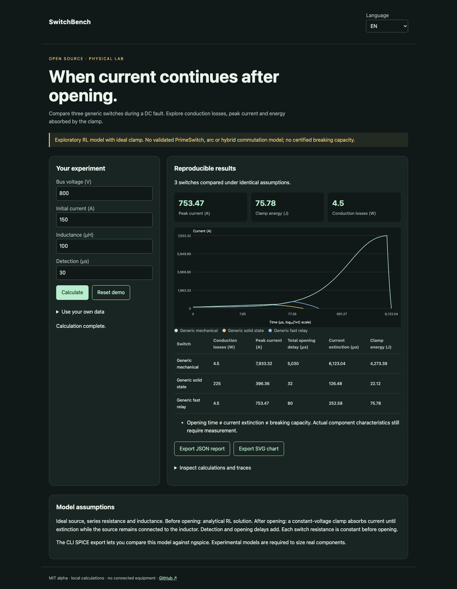

# SwitchBench

[Français](README.md) · English · [Español](README.es.md)

A reproducible DC fault bench: losses, opening, extinction and clamp energy.



## Try it in a minute

Node.js 22+ is sufficient for calculations and the demo. No account or API key. Open http://127.0.0.1:4321/?lang=en. `PORT=4322 npm start` changes the port; loopback only.

```sh
git clone https://github.com/gbesse/switchbench.git
cd switchbench
node bin/cli.js demo --locale=en
npm start
```

## Use your own data

The `fixtures/` directory contains examples. The interface accepts a file or edited JSON and exports JSON reports and SVG charts. Language changes labels, never user data or identifiers. CLI exports use exclusive `--output=new-file` creation and never overwrite existing files. Each CLI report includes SHA-256 hashes of input bytes; these do not establish measurement authenticity.

Edit a scenario JSON. `ngspice` is optional for analytical comparisons; install it on PATH to use `spice`. The engine runs only generated netlists, never arbitrary user-provided netlists.

```sh
node bin/cli.js run fixtures/demo.json --locale=en
```

Export: `node bin/cli.js netlist fixtures/demo.json --device=fastRelay --output=new.cir`. Run: `node bin/cli.js spice fixtures/demo.json --device=fastRelay`. Verify all three devices: `SWITCHBENCH_NGSPICE=ngspice npm test`. SPICE uses a diode clamp and 1 ns edges; tests require less than 1% peak-current and 2% energy discrepancy.

## Method and limitations

Abstract circuit: ideal source → resistor → inductor → switch. Before opening: `I(t) = V/R + (I0 − V/R) exp(−Rt/L)`. After opening: constant clamp `Vc > V`, current decays to extinction. Analytical calculation and energy conservation. The source still feeds the inductor during decay: absorbed energy is not merely `½ L I²`.

Three generic devices: mechanical 5 ms / 200 µΩ, solid state 2 µs / 10 mΩ, fast relay 50 µs / 200 µΩ. The fast relay uses two public PrimeSwitch values as a scenario, not a validated vendor model. No hybrid commutation, arc, bounce, parasitic capacitance, thermal derating or source limitation. Opening time and isolation are not breaking capacity.

Voltages in V (bus ≤ 10,000, clamp ≤ 20,000), initial current in A, inductance in µH (≤ 100,000), resistances in Ω (fault ≥ 10⁻⁵), delays in µs (≤ 100,000 each). The chart uses log₁₀(1+t) on its time axis.

## Verify

Tests check physical or statistical laws, invalid inputs, exports and browser flows in all three languages.

```sh
npm ci
npm test
npx playwright install chromium
npm run test:browser
npm run format:check
```

## Next evidence sought

A public hybrid-breaker model compared against experimental waveforms, with commutation, arc and clamp parameters.

## Status and contribution

Independent MIT alpha, not affiliated with Atomic Machines. No access to their hardware or API. Not published on npm. Demo fixtures are synthetic. Contribute a reproducible case with assumptions, units and expected results; publish only data you are authorized to share.

## Sources and related tools

[PrimeSwitch](https://www.atomicmachines.com/primeswitch) · [ngspice](https://ngspice.sourceforge.io/) · [NVIDIA 800 VDC](https://www.nvidia.com/en-sg/data-center/technologies/800-vdc-architecture/)
