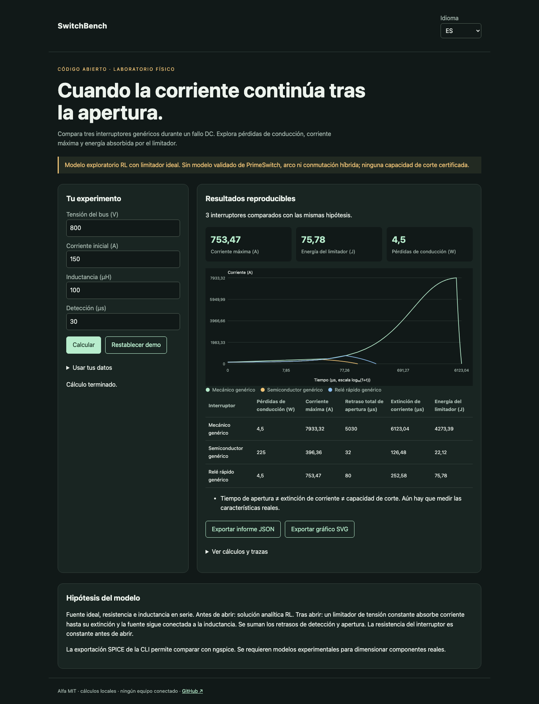

# SwitchBench

[Français](README.md) · [English](README.en.md) · Español

Un banco reproducible para fallos DC: pérdidas, apertura, extinción y energía del limitador.



## Probar en un minuto

Node.js 22+ basta para los cálculos y la demo. Sin cuenta ni clave API. Abrir http://127.0.0.1:4321/?lang=es. `PORT=4322 npm start` cambia el puerto; solo escucha local.

```sh
git clone https://github.com/gbesse/switchbench.git
cd switchbench
node bin/cli.js demo --locale=es
npm start
```

## Usar tus datos

El directorio `fixtures/` contiene ejemplos. La interfaz acepta archivos o JSON editado y exporta informes JSON y gráficos SVG. El idioma cambia etiquetas, nunca datos del usuario ni identificadores. Las exportaciones CLI se crean exclusivamente con `--output=archivo-nuevo` y no sobrescriben archivos existentes. Cada informe CLI incluye hashes SHA-256 de los bytes de entrada; no prueban la autenticidad de las mediciones.

Editar un escenario JSON. `ngspice` es opcional para comparar analíticamente; debe estar en PATH para usar `spice`. El motor ejecuta solo netlists generadas, nunca netlists arbitrarias del usuario.

```sh
node bin/cli.js run fixtures/demo.json --locale=es
```

Exportar: `node bin/cli.js netlist fixtures/demo.json --device=fastRelay --output=nuevo.cir`. Ejecutar: `node bin/cli.js spice fixtures/demo.json --device=fastRelay`. Verificar los tres componentes: `SWITCHBENCH_NGSPICE=ngspice npm test`. SPICE usa limitador de diodo y flancos de 1 ns; el test exige menos de 1 % de diferencia de pico y 2 % de energía.

## Método y límites

Circuito abstracto: fuente ideal → resistencia → inductancia → interruptor. Antes de abrir: `I(t) = V/R + (I0 − V/R) exp(−Rt/L)`. Tras abrir: limitador constante `Vc > V`, corriente hasta extinción. Cálculo analítico y conservación de energía. La fuente sigue alimentando la inductancia durante el descenso: la energía absorbida no es solo `½ L I²`.

Tres componentes genéricos: mecánico 5 ms / 200 µΩ, semiconductor 2 µs / 10 mΩ, relé rápido 50 µs / 200 µΩ. El relé rápido usa dos valores públicos de PrimeSwitch como escenario, no como modelo validado del fabricante. Sin conmutación híbrida, arco, rebote, capacidad parásita, reducción térmica ni limitación de fuente. Apertura y aislamiento no son capacidad de corte.

Tensiones en V (bus ≤ 10 000, limitador ≤ 20 000), corriente inicial en A, inductancia en µH (≤ 100 000), resistencias en Ω (fallo ≥ 10⁻⁵), retrasos en µs (≤ 100 000 cada uno). El gráfico usa log₁₀(1+t) en el eje temporal.

## Verificar

Los tests comprueban leyes físicas o estadísticas, entradas no válidas, exportaciones y recorridos del navegador en los tres idiomas.

```sh
npm ci
npm test
npx playwright install chromium
npm run test:browser
npm run format:check
```

## Siguiente prueba buscada

Un modelo público de interruptor híbrido comparado con oscilogramas experimentales, con parámetros de conmutación, arco y limitador.

## Estado y contribución

Alfa independiente con licencia MIT, sin afiliación con Atomic Machines. Sin acceso a su hardware ni API. No publicado en npm. Los ejemplos son sintéticos. Contribuye un caso reproducible con hipótesis, unidades y resultados esperados; publica solo datos que estés autorizado a compartir.

## Fuentes y herramientas relacionadas

[PrimeSwitch](https://www.atomicmachines.com/primeswitch) · [ngspice](https://ngspice.sourceforge.io/) · [NVIDIA 800 VDC](https://www.nvidia.com/en-sg/data-center/technologies/800-vdc-architecture/)
