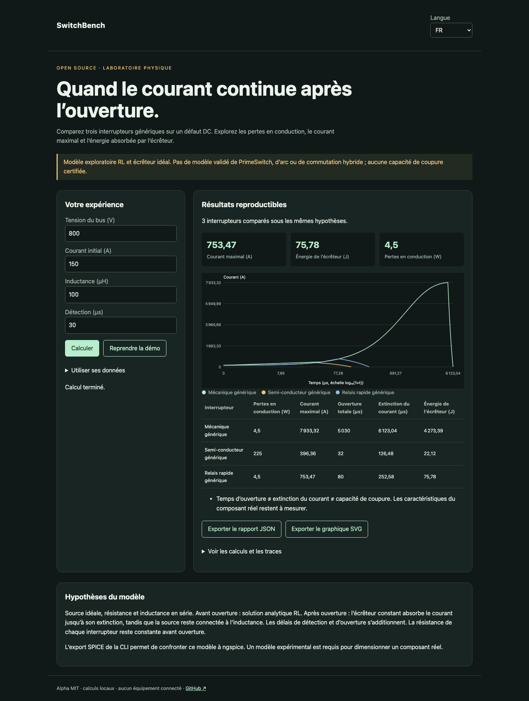

# SwitchBench

Français · [English](README.en.md) · [Español](README.es.md)

Un banc reproductible pour les défauts DC : pertes, ouverture, extinction et énergie d’écrêtage.



## Essayer en une minute

Node.js 22+ suffit pour les calculs et la démo. Aucun compte, aucune clé API. Ouvrir http://127.0.0.1:4321/?lang=fr. `PORT=4322 npm start` change le port ; écoute locale uniquement.

```sh
git clone https://github.com/gbesse/switchbench.git
cd switchbench
node bin/cli.js demo --locale=fr
npm start
```

## Utiliser ses données

Le dossier `fixtures/` contient les exemples. L’interface accepte un fichier ou un JSON édité et exporte le rapport JSON et le graphique SVG. La langue change les libellés, jamais les données utilisateur ni les identifiants. Les exports CLI sont créés exclusivement avec `--output=nouveau-fichier` et n’écrasent aucun fichier existant. Chaque rapport CLI contient l’empreinte SHA-256 des octets d’entrée ; elle ne prouve pas l’authenticité des mesures.

Modifier un scénario JSON. `ngspice` est facultatif pour la comparaison analytique ; il doit être installé dans le PATH pour la commande `spice`. Le moteur exécute seulement les netlists générées, jamais une netlist arbitraire fournie par l’utilisateur.

```sh
node bin/cli.js run fixtures/demo.json --locale=fr
```

Exporter : `node bin/cli.js netlist fixtures/demo.json --device=fastRelay --output=nouveau.cir`. Exécuter : `node bin/cli.js spice fixtures/demo.json --device=fastRelay`. Vérifier les trois composants : `SWITCHBENCH_NGSPICE=ngspice npm test`. Le modèle SPICE utilise un écrêteur à diode et des fronts de 1 ns ; le test exige moins de 1 % d’écart sur le pic et 2 % sur l’énergie.

## Méthode et limites

Circuit abstrait source idéale → résistance → inductance → interrupteur. Avant ouverture : `I(t) = V/R + (I0 − V/R) exp(−Rt/L)`. Après ouverture : écrêteur constant `Vc > V`, courant jusqu’à extinction. Calcul analytique et conservation de l’énergie. La source alimente encore l’inductance pendant la décroissance : l’énergie absorbée ne se réduit pas à `½ L I²`.

Les trois composants sont génériques : mécanique 5 ms / 200 µΩ, semi-conducteur 2 µs / 10 mΩ, relais rapide 50 µs / 200 µΩ. Le relais rapide reprend deux valeurs publiques de PrimeSwitch comme scénario, sans représenter un modèle constructeur validé. Aucune commutation hybride, arc, rebond, capacité parasite, déclassement thermique ou limitation de source. Temps d’ouverture et isolation ne sont pas une capacité de coupure.

Tensions en V (bus ≤ 10 000, écrêteur ≤ 20 000), courant initial en A, inductance en µH (≤ 100 000), résistances en Ω (défaut ≥ 10⁻⁵), délais en µs (≤ 100 000 chacun). Le graphique emploie log₁₀(1+t) sur l’axe du temps.

## Vérifier

Les tests vérifient les lois physiques ou statistiques, les entrées invalides, les exports et les parcours navigateur dans les trois langues.

```sh
npm ci
npm test
npx playwright install chromium
npm run test:browser
npm run format:check
```

## Prochaine preuve recherchée

Un modèle public de disjoncteur hybride confronté à des oscillogrammes expérimentaux, avec paramètres de commutation, arc et écrêteur.

## Statut et contribution

Alpha indépendante, licence MIT, sans affiliation avec Atomic Machines. Aucun accès à leur matériel ou à leur API. Aucun package publié sur npm. Les fichiers de démonstration sont synthétiques. Contribuer avec un cas reproductible, les hypothèses, les unités et les résultats attendus ; ne publier que des données que vous êtes autorisé à partager.

## Sources et outils voisins

[PrimeSwitch](https://www.atomicmachines.com/primeswitch) · [ngspice](https://ngspice.sourceforge.io/) · [NVIDIA 800 VDC](https://www.nvidia.com/en-sg/data-center/technologies/800-vdc-architecture/)
